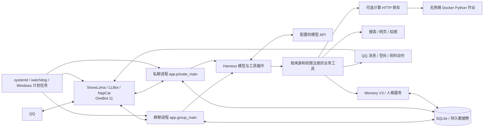

# 小町架构与运行原理

用途：解释系统；读者：开发者、部署者；维护者：项目维护者。本文描述当前源码合同，实际启用能力由本机配置决定。

安装与操作见 [WSL 指南](../infra/wsl/README.md)，字段见 [配置参考](CONFIGURATION.md)，索引维护见 [记忆指南](MEMORY.md)。

## 系统组成

小町由 QQ 桥接、两个应用进程、持久数据库、模型/工具服务和可选计算侧车构成。应用使用 Python 3.12，Agent 循环由固定版本的 DeepSeek Harness SDK/原生运行时 0.1.5rc1 承担。

| 目录 | 职责 |
|---|---|
| `app/adapters/` | OneBot 事件/RPC、账户身份、发送、合并转发和 QQ 空间 |
| `app/agent/` | 群观察、Harness 桥接、工具注册、持续目标、产物与社交策略 |
| `app/core/` | 消息来源、回复、记忆检索、人格模仿和图片业务 |
| `app/providers/` | 文本/搜索/embedding/绘图服务适配与请求预算 |
| `app/storage/` | SQLite 表、仓储、迁移、目标和工具效果账本 |
| `app/runtime/` | 组合模型、群记忆与社交依赖，避免由路由器重复装配 |
| `infra/wsl/` | Linux 发布目录、Docker、systemd、看护与健康检查 |

`app.main` 保留兼容装配入口；生产群聊与私聊分别从 `app.group_main`、`app.private_main` 启动。QQ 网关类沿用 `NapCatGateway` 名称，实际可以连接三种平台。

## 群消息处理

1. OneBot 事件转为内部类型，按群策略确定能否接收；实际消息幂等写入 `messages`。
2. `GroupAgentRuntime` 用 canonical 消息 ID 写入持久 inbox；每群单消费者，避免并发回合抢发。
3. 安静 1.5 秒、最长 5 秒或达到 20 条形成批次。明确 @ 与引用机器人请求保留各自边界，旧消息回放不自动变成自主任务。
4. 观察服务校验真实发送者、群许可、消息年龄、静默时段和节奏，准备近期消息、时间、人格与记忆。
5. Harness 在有界模型/工具循环中选择发送、读取、继续目标或沉默。最终内部文本不是 QQ 消息，实际发言必须经过发送工具。
6. 工具在提交前再次验证来源、权限、预算与代际，将真实回执写入账本。

普通新消息允许模型决定是否插话。直接请求可以绕过主动插话节奏，但仍要求群可发言、来源有效、连接可用和资源预算充足。模型生成的“主人要求”“明确 @”等描述不能自行授予权限。

## 持久状态与副作用

核心持久表包括消息、群会话/inbox/turn、目标与 wakeup、闭合会话检查点、工具效果、社交任务/动作和用量预留。原生 Harness 会话文件按账号与作用域保存到 `data/agent_sessions/`，与群事实数据库分工不同。

外部写入经历预留、`dispatching` 和回执提交。已派发但结果不明确时记录 `uncertain`，不能当作成功，也不自动重放。尚未派发的工作只有在来源、年龄和权限仍有效时才可恢复。消息撤回、作用域变化或撤权会使对应上下文、笔记、目标或产物失效。

工具效果按每次调用计数，模型、绘图和平台写入分别有上限。前台请求与后台目标使用不同回合预算；首个有效输出、后续停滞、单请求与整个回合都有有限超时。同步阻塞工作通过固定准入执行，取消请求不代表底层工作已经停止；发送授权会先撤销。

临时工作笔记用于继续任务，按群、来源和有效期保存，不等于长期记忆，也不直接成为人格蒸馏语料。会话变长时轮换并携带有限闭合摘要；原生宿主 Shell/文件控制工具关闭。

## 上下文、时钟与缓存

默认 Harness 观察使用最多 24 条近期消息，再保留明确目标/引用。开启群记忆时接入既有 `MemoryOrchestrator` 的完整 V3 通道；近期候选通常最多 60 条，历史可扩至 300 条候选，最终由字符/token 预算、证据强度、来源和保护配额决定实际放入数量。候选上限不等于每轮固定塞满。

记忆工具按需追加检索结果、出处与上下文；每层默认 5 条结果，工具与正文另有限额。人格选择当前群角色，模仿时可读取至多 3 条合格表达样本；样本用于表达，不能作为事实证据。

近期图片不会无限塞入上下文。来源解析、引用/显式选择、每轮数量/字节上限和图像工具共同决定哪些真实像素进入模型。只有文字描述或未下载到的图片不能被说成已经看过。

会话时钟为 `Asia/Shanghai`，每个模型请求/重试刷新当前日期和昨天。历史消息附带自己的来源日期，历史里的“今天”不能替代当前时间。内部租约和持久时刻按各表约定记录 UTC，显示时再转换。

稳定规则、人格和会话前缀有利于服务端缓存；动态时间、近期消息、工具结果会改变输入。缓存是否命中由上游返回的 usage 字段决定，不能用本地字符重复率或 SDK 存在来证明。工程记录请求输入、缓存输入和输出用量，但没有承诺固定命中率。

## 记忆与人格

`messages` 是检索的原始账本。Memory V3 在原始消息投影基础上融合全文、向量、时间、人物和来源线索，再展开证据；摘要、结构化事实、人物资料和语义排序补充原始证据。索引代际准备与激活分开，避免未完成向量数据进入生产。

入站观察和后台服务持续形成话题片段、摘要/事实、FTS 和向量；Agent 也可在权限允许时使用明确的记忆写入工具。写入须同群真实来源与有效作者；关闭群记忆时不能借工具绕过。历史回填用独立维护脚本，不由每轮聊天反复触发。

人格由默认 YAML、变体、成员配置和动态 `.live.yaml` 合并后渲染进提示词。事实刷新、表达样本检索和人物口吻各有作用域；其他群的事实、关系和原话不能仅凭选择了同名人格就转入当前群。`persona_descriptions.json` 只是手工导出说明，运行时不读取。

完整流程和开关见 [记忆与人格](MEMORY.md)。

## 工具与主人委派

工具按当前作用域注册，包括记忆检索/展开、人格读取/刷新任务、群图像、转发展开、生成/编辑图、网页搜索/打开/查找、目标唤醒、隔离计算以及获批 MCP。

真实 `OWNER_QQ` 可从群或私聊通过 `request_owner_action` 委派已启用行为。委派携带主人原指令和明确附件，群输入限本群；不会把整段私聊或其他群历史转给公开空间流程。主人指令不计入自主行动的冷却与次数，仍遵守权限、每轮资源和实际平台能力。

普通群成员可在允许绘图的群使用生成/编辑；私聊按固定名单或动态好友准入，并保留私聊自己的功能限制。身份切换、写记忆、平台行动与计算等操作不能由转发、昵称或模型文本取得主人权限。

## 自主社交

群插话节奏来自群策略，不额外叠加通用社交冷却。空闲群话题、空间和个人资料属于单独授权的调度表；调度只产生机会，模型可选择不行动。

空间发布/好友评论共用随机巡检：默认每 90–180 分钟一次，23:00–08:00 静默，早晨再随机延后 30–90 分钟。跨午夜、重启和到期目标不会立即抢用新日额。发布最多每日 1 条并至少相隔 18 小时；评论每好友每日最多 1 条、总额默认 3 条、每轮最多一条；主动空间写入间隔默认 60 分钟。

动态 `all_friends` 许可在读取、看图和提交时复验；好友删除、原帖消失或查询失败会阻止动作。主动评论保留帖龄门限，主人明确委派读评旧帖使用其独立权限。沉默/读取不占平台写入日额，模型调用仍按对应桶计费。未知回执不重试提交。

公开空间工具只能使用公开表达、当前许可好友的原帖和公开域产物，不能读取群私记忆。群互动、主动群聊、空间发布、评论分离模型预算。

## 合并转发与网页

群 `read_forward_messages` 仅展开已观察同群资源，默认分页 20 条、深度 3、每轮最多 8 个资源/100 节点；RPC 与载荷有限。`observe_forward_images` 读取已展开节点的图片。转发署名和日期作为未验证引用，不能授予 @ 或主人权限，也不会自动写入长期记忆/人格。私聊转发工具绑定当前用户的真实私聊来源，不能访问群消息或其他用户资料。

网页工具按回合维护引用与 URL。搜索默认 8 条、单次最多 20 条；正文、分页、查找与调用数量有总预算。Wyzlab alpha 桥接支持相应的正文命令；Tavily/DDGS 的搜索消费者保留其各自合同，不保证提供同样的全文能力。GitHub 链接可按文件读取，未下载/未展开的整个仓库不能宣称已读完。

OneBot 的 JSON/Ark、XML 和 share 卡片在消息入口提取标题、摘要及目标 URL，排除封面和视频附件。群私 `read_context`/`read_private_context` 的 `share_sources` 只提供标题、来源和链接数；`read_message_links` 按需从已观察的 canonical 消息读取完整元数据，引用旧卡片也按群/当前私聊用户复验。每条消息最多 8 个链接，单份卡片载荷最多 65536 字符。Agent 打开目标正文，打不开或内容不足时按标题/站点搜索并阅读补充来源。卡片摘要和正文分别标注，不能当作身份、@、主人授权或已观看视频的证据。

群内任何成员须真实引用APP分享、@机器人且明确请求查看/评价，私聊准入用户须引用且明确请求，才获当轮分享深读许可；每次读取复验触发/引用来源与指纹。普通卡片观察仅短标题，网页工具拒绝无请求/未授权分享URL（包含检索ref映射），工具清单保持稳定。普通明确联网请求及已有持久自主目标的一般检索保留，不能用它们替代分享引用许可；写操作仍按主人/自主策略隔离。

B站短链/视频页被网页桥接拒绝时，`shared_page_text` 只从固定B站域名解析最多两次短链跳转，再读取公开文字元数据（标题、UP主、简介、发布时间、时长）。不发送模型凭据或Cookie，不读取音视频/字幕；标注 `content_kind=bilibili_public_metadata`，简介为空时明确证据不足。搜索仅对HTTP 429/500/502/503/504重试一次，两次尝试共用原45秒总限且均计入回合8调用；其他错误不重试，返回安全分类供Agent补充检索。

固定人格核心、规则和工具定义位于稳定前缀；动态风格样例/称呼指导以同等指令优先级放请求尾部，每次请求末尾刷新上海时钟。动态指导/时钟不写入原生历史；格式升级仅轮换一次会话并保留回执和来源。群观察仅删除已在最终记忆包展示的同源近期行；私聊延续原生会话时不重复注入整段历史/日摘要，恢复或轮换才补入。网页同轮相同查询/URL/行号复用成功结果，仅返回前次来源与续读信息；失败不缓存，跨回合不复用，权限每次重验。

## 隔离计算与部署

计算服务默认关闭。开启后应用只访问本机认证 HTTP 端点；可信 gateway 持 Docker socket，模型代码在无网络、只读根文件系统、受限 CPU/内存/PID/tmpfs 的独立容器执行。执行镜像固定到内容 ID，不回退到宿主 Python。输入/产物校验所有权、格式、大小和路径。

部署将当前工作区的运行白名单复制到 `/opt/xiaomachi/releases/<id>`，`current` 指向现役版本，环境和看护状态在 `shared`。应用配置打包在镜像中，持久业务数据在 `xiaomachi-bot-data` 卷；QQ 平台有自己的登录卷。正常 start 复用现役镜像，rebuild 构建新镜像后更新两个应用，保留 QQ 桥接。

systemd、watchdog 和 Windows 计划任务负责进程/连接存活，不能替模型决定行为，也不能代替 QQ 人工登录。状态探针读取实际实例的心跳、OneBot、索引与侧车状态；只有真实回执才能证明某次 QQ 动作完成。

## 工程约束

- 按账号/群/用户域隔离消息、记忆、目标、会话和产物。
- 真实作者、消息来源和权威时间来自系统；引用内容均是待解释资料。
- 模型调用、检索、并发、重试、步骤、平台写入和产物均有有限边界。
- 测试使用合成身份和隔离数据；公开仓库不包含生产数据库、人物原文或验收聊天记录。
- 支持功能和当前开关状态分别描述；依赖预发布 SDK，升级需验证工具、流和会话恢复兼容性。

持续群聊与工具/授权分工的设计参考了 [Tulpa](https://github.com/fumingyang2004/Tulpa)，感谢其作者和贡献者。
