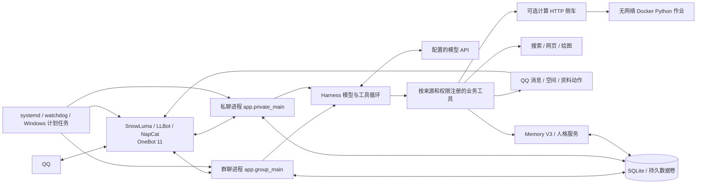

# 小町架构与运行原理

用途：解释系统；读者：开发者、部署者；维护者：项目维护者。本文描述当前源码合同，实际启用能力由本机配置决定。

安装与操作见 [WSL 指南](../infra/wsl/README.md)，字段见 [配置参考](CONFIGURATION.md)，索引维护见 [记忆指南](MEMORY.md)。

## 系统组成

小町由 QQ 桥接、两个应用进程、持久数据库、模型/工具服务和可选计算侧车构成。应用使用 Python 3.12，Agent 循环由固定版本的 DeepSeek Harness SDK/原生运行时 0.1.5rc1 承担。

| 目录 | 职责 |
|---|---|
| `app/adapters/` | OneBot 事件/RPC、账户身份、发送、合并转发和 QQ 空间 |
| `app/agent/` | 群观察、Harness 桥接、工具注册、持续目标、产物与社交策略 |
| `app/core/` | 消息来源、回复、记忆检索、人格模仿和图片业务 |
| `app/providers/` | 文本/搜索/embedding/绘图服务适配与请求预算 |
| `app/storage/` | SQLite 表、仓储、迁移、目标和工具效果账本 |
| `app/runtime/` | 组合模型、群记忆与社交依赖，避免由路由器重复装配 |
| `app/monitor/` | 可选本机只读 Agent 输入、过程、输出与回执网页 |
| `infra/wsl/` | Linux 发布目录、Docker、systemd、看护与健康检查 |

`app.main` 保留兼容装配入口；生产群聊与私聊分别从 `app.group_main`、`app.private_main` 启动。QQ 网关类沿用 `NapCatGateway` 名称，实际可以连接三种平台。

X/Twitter单帖媒体由共享provider解析与下载，机器人经媒体队列接入群私工具，独立CLI仍可手动运行。仅解析指定帖本身，媒体CDN及逐跳重定向受白名单、时限、重试、文件/总量限制；不读取浏览器登录态。机器人结果注册到有来源的产物和受控缓存，CLI结果由调用者管理。使用方式见[工具清单](TOOLS.md)。

## 群消息处理

1. OneBot 事件转为内部类型，按群策略确定能否接收；实际消息幂等写入 `messages`。
2. `GroupAgentRuntime` 用 canonical 消息 ID 写入持久 inbox；每群单消费者，避免并发回合抢发。
3. 安静 1.5 秒、最长 5 秒或达到 20 条形成批次。明确 @ 与引用机器人请求保留各自边界，旧消息回放不自动变成自主任务。
4. 观察服务校验真实发送者、群许可、消息年龄、静默时段和节奏，准备近期消息、时间、人格与记忆。
5. Harness 在有界模型/工具循环中选择发送、读取、继续目标或沉默。最终内部文本不是 QQ 消息，实际发言必须经过发送工具。
6. 工具在提交前再次验证来源、权限、预算与代际，将真实回执写入账本。

普通新消息允许模型决定是否插话。直接请求可以绕过主动插话节奏，但仍要求群可发言、来源有效、连接可用和资源预算充足。模型生成的“主人要求”“明确 @”等描述不能自行授予权限。

需要回应的消息按进入群收件箱的顺序处理。直接回合只消费到当前目标为止，后续消息留在持久队列中分别回答；不能回复了一条名字提及就把同批其他 @ 一并标成已处理。

主动参与另有有效新消息门槛和高价值参与规则，默认至少 4 条不同的有效发言；纯附和、复读和随口调侃不足以发言。入口与最终发送共用 `GroupObservationService`，周期群唤醒也提前检查，抑制期间不启动额外参与判定。既有事件目标到期可继续读取/整理，实际群发送仍须通过共同门控。具体配置见 [群策略](CONFIGURATION.md#群策略)。

`group_participation_feedback` 保存每群最近一条可核实的嫌烦反馈及静默/降频期限。轻量规则结合 canonical 引用、近期机器人发言和被指向的对象识别无名字的闭嘴请求；不增加逐消息 LLM 调用。反馈期限从来源时间计算，重放不能续期；发送前复验来源，撤回或过期后失效。反馈处理中不以嘴臭人格反击投诉，普通直接提问仍可回复。

## 持久状态与副作用

核心持久表包括消息、群会话/inbox/turn、目标与 wakeup、闭合会话检查点、工具效果、社交任务/动作和用量预留。原生 Harness 会话文件按账号与作用域保存到 `data/agent_sessions/`，与群事实数据库分工不同。群后台目标使用 `background:group:<群>` 的独立检查点及原生目录；普通群巡检只做无工具、无历史的轻量参与判断，批准后与直接互动一样在 `group:<群>` 正式回复。群资料、产物、费用和发送权限沿用群作用域及串行锁，静默判断和后台执行过程不会注入主会话历史，正式群发言及真实回执按群可查。

群聊和私聊的 `read_self_activity` 按上海日期查询当前机器人账号的空间发布回执，独立上下文和进程重启不影响查询。查询只读既有工具效果及历史直接发布账本，排除run_tools唤醒外壳，并对同一工具唤醒去重；成功必须已调度且有真实回执，dispatching/uncertain/缺回执的sent为未知。计数覆盖整日，明细最多64条；不返回群私来源、好友评论或后台过程。无记录只代表本系统无确认发布，不否认QQ手动活动；未知不会触发补发。

外部写入经历预留、`dispatching` 和回执提交。已派发但结果不明确时记录 `uncertain`，不能当作成功，也不自动重放。尚未派发的工作只有在来源、年龄和权限仍有效时才可恢复。消息撤回、作用域变化或撤权会使对应上下文、笔记、目标或产物失效。

工具效果按每次调用计数，模型、绘图和平台写入分别有上限。前台请求与后台目标使用不同回合预算；首个有效输出、后续停滞、单请求与整个回合都有有限超时。同步阻塞工作通过固定准入执行，取消请求不代表底层工作已经停止；发送授权会先撤销。

群私直接互动在共享Harness入口建立`RequestTaskControl`轻量目标，不依赖模型先开正式任务。保守识别明确下载/资料目标，主模型可在原回合用`set_task_goal`补充语义要求，不能扩大权限或删除明确媒体要求；普通聊天不另加规划调用。工具反馈区分搜索摘要、已读原文、来源记忆、owned产物和真实回执，日期/作者未核实不升级为事实，空搜索不证明不存在。连续无新目标证据时提示换方法，三次无进展后拒绝继续改词搜索；未达到可判定交付要求时发送前反馈缺口。允许有据受阻或部分产物交付，不用文字冒充图片视频完成。

复杂目标仍复用`ResearchTaskWorkspace`保存剩余项、证据索引与下一步。Harness分别记录传输状态和任务完成度，后台待办、未知写入和缺失产物/回执不能被自报completed覆盖；正式任务尚active时不因阶段送达截断。必要时原预算内最多一次续办；反复无进展/提前结束时最多一次独立短诊断（512输出token，最多等待20秒，共用回合与每日调用额度），无工具权限、不复制主历史。失败诊断不污染主会话恢复。语义范围仍标模型报告，程序不能机械证明作者、日期或检索穷尽。取消沿用原账号、任务、群私及提问者校验。

每提问者/作用域只保存最新轻量目标，不为普通聊天逐条堆目录、不激活研究预算；正式检查点和队列负责持续任务。仅有实际产物/证据及确认交付、无未解决工具错误时记录方法经验，7天有效，匹配模型/provider及工具schema版本，撤回或依赖失效即不可读。每次按需最多提示两条简短方法，放动态尾部，不作为权限、事实记忆或人格。现有群V3保持原边界，普通私聊不新增群记忆接线。

工具定义提供稳定的执行方式和副作用说明。`read`表示不走外部写入预留，部分工具仍会保存本地状态或排队；描述性合同不授予权限，研究子任务继续使用显式只读白名单。URL可来自本次授权内发现的来源，各工具按输入类型消费URL、候选、证据或产物句柄，不能用任意字符串替换引用。站点名不决定固定调用顺序。

临时工作笔记用于继续任务，按群、来源和有效期保存，不等于长期记忆，也不直接成为人格蒸馏语料。恢复旧任务时先复验当前/原始来源、本轮200条预算和独立历史依赖快照；失败不扩张本轮来源或记忆依赖。会话增长由统一原生压缩维护，重建保留闭合任务和实际回复；原生宿主Shell/文件控制工具关闭。

## 上下文、时钟与缓存

当前上下文格式11沿用检索候选、实际入模证据与历史依赖分离。V3共享packer按独立Agent记忆预算选完整单元，自动召回不再复制近期观察，尾部不二次删已准入证据；显式工具结果仍保留协议配对。主对话总输入软阈值96000、目标64000，硬保护受模型预留约束，不再用24000历史估算抢先换段。历史来源/修订存入独立依赖表，不与当前读取200条混用，来源失效仍优先于缓存；后台任务、笔记和产物通过7天不可变快照继续复验。压缩摘要保守继承全部依赖，无法精确删除时重建该受污染执行输入；资源上限失败关闭，原始记忆与外部动作账本不被裁剪。

默认 Harness 观察使用最多 30 条近期消息，再保留明确目标/引用。开启群记忆时接入既有 `MemoryOrchestrator` 的完整 V3 通道；近期候选通常最多 60 条，历史可扩至 300 条候选，最终由字符/token 预算、证据强度、来源和保护配额决定实际放入数量。候选上限不等于每轮固定塞满。

群私`重置上下文`在模型前解析，仅真实独立文本指令生效；获准私聊用户控制本人会话，群共享会话仅主人明确@可重置。默认群30/私40条，数量指原始消息而非token或轮数；私聊原生历史连续保留，40条是恢复快照预算，旧日常路径的20条窗口不等于原生历史。`context_resets`及`context_excluded_messages`保存重置和精确来源排除，Message只读派生标志接入统一来源守卫，原文和JSON不改写。原子事务清空群主/后台检查点与依赖快照、便笺、旧私聊摘要入口和未完成工作；新原生ID不重放旧日志。旧任务来源不得恢复到新工作区，排除来源的记忆/引用/像素也拒绝入模。群执行器另有持久重置代次守卫，原生/工具晚返回和旧回流不能提交；指令后的消息与任务保留。发送账本不删除，恢复仅提供内容无关的回执身份；已开始的外部写入仍按原回执或未知状态结算。用法见[工具参考](TOOLS.md#聊天历史与感知)。

记忆工具按需追加检索结果、出处与上下文；每层默认 5 条结果，工具与正文另有限额。人格选择当前群角色，模仿时可读取至多 3 条合格表达样本；样本用于表达，不能作为事实证据。

群直接看图按当前消息、明确引用或3分钟内同发送者紧邻的指图请求选取来源；“先发图，再@问这图怎么样”仍可读取，普通文字不自动附带无关群图。主动观察仅在最新来源确为近期图片事件时附图。来源复验、每轮数量/字节上限和图像工具限制实际像素，未取得像素或指向失效时须说明缺口。

最终模型请求保留本轮及本轮工具读取的媒体，前轮媒体像素投影为省略标记，内部压缩不携带像素；原始会话/聊天和图片存储不改写。明确上游图片/输入拒绝与普通interrupted分开分类，不重试同一被拒输入。失败/未知回合不进入闭合恢复上下文或私聊日摘要；已发出回复后又发生模型拒绝、流中断或超时，同样禁止复用其执行历史，真实发送回执独立保留。失败会话下一轮换新原生ID，仍保留正常闭合历史、任务检查点和实际写入回执；格式升级同样只轮换原生执行会话，未知外部写入继续禁止重放。

会话时钟为 `Asia/Shanghai`，每个模型请求/重试刷新当前日期和昨天。历史消息附带自己的来源日期，历史里的“今天”不能替代当前时间。内部租约和持久时刻按各表约定记录 UTC，显示时再转换。

稳定规则、人格和会话前缀有利于服务端缓存；动态时间、近期消息、工具结果位于输入尾部。同一作用域与配置下，主人/成员使用相同、按名称排序的工具定义；身份只进入本轮authority观察，受限工具在执行、费用预留及副作用账本前拒绝越权。记忆引用门控、资料回传禁止再次委派及交付预算均保留定义、在调用时限制；群发送schema保持12000字符，非直接发言仍由发送层限制300字符。配置/人格变更可以改变前缀。缓存命中以上游usage为准，不用本地重复率证明。格式10仅轮换原生会话，保留闭合摘要、任务和真实回执。

V3预加载和记忆工具保留packer的精确证据块边界，原子聊天证据段不拆散；持久互动只保留一份块序列；格式10的群临时观察不写入原生历史。最终请求按活跃历史从旧到新投影，同一来源与内容的证据块、观察条目、分享来源和真实回执只提供一次，当前目标、引用、主体绑定和变化的回执仍保留。群策略只复用相邻唤醒都存在的相同规则；直接互动、普通唤醒等行动要求切换后重新出现时必须重申。去重索引每次从实际输入重建，不用全局已读标记；压缩或轮换后缺失的证据会重新提供。旧格式或块重组不匹配时保留完整正文。来源和语义版本继续在每轮及发送前复验；复用不跳过V3检索、不新增辅助模型调用。观测记录复用块/条目/回执数量及本轮输入估算，账单仍以实际usage为准。格式迁移仅轮换原生会话，正常闭合摘要、任务与真实回执按既有恢复合同保留。

群私消息始终先进入原主会话，关键词和“继续”不切换上下文。主模型判断资料量较大时显式调用 `delegate_research_task(goal, reason, deliverable, source_ids?)`，每轮最多一次；排队不等于完成。`delegated_research` 持久队列按账号/群私进程消费，子任务使用独立 `research:` 原生会话和执行器，主对话可继续回复新消息。子任务身份为专用只读执行器，不带人格、主对话历史或记忆正文；默认只传当前请求来源，模型可显式选取已见且合法的必要来源，总计最多8条。续做仅带少量检查点和证据ID。子任务从canonical来源重建网页、分享、转发及任务记录的只读工具，没有发送、行为写入或递归委派权限，来源/分享许可和费用限额仍复验。

子任务窗口最多32000 token且不超过模型窗口，输出最多4096 token，窗口55%压力处压缩、保留最多3200近期token，内部摘要最多1024输出token；每轮内部总结仍最多2次。单任务最多300秒、现有任务网页预算不变。研究和媒体队列各自按进程最多16个活动任务、每提问者每作用域最多4个；其余存为pending，活动加待办最多512个/进程、128个/提问者作用域，释放容量后依序晋升并复验。结束回传最多6000字符的结论、少量证据及资源清单句柄；全部已发现URL通过read_research_resources每页20项读取，原文按证据ID分段读取。原主会话核验摘要后使用人格调用真实发送工具，结果回传轮保留定义但禁止再次委派。原请求有效的内部续办可继续获准联网，普通timer和自主巡检不获得该权限。该边界限制工作集，不承诺真实账单或完整仓库覆盖。

`data/research_tasks/` 保存7天有效的目标、覆盖、缺口、下一步与分段证据，旧任务须模型显式选择task_id。任务文件不自动导入V3事实或人格；恢复和结果回传复验原始消息、群隔离和V3语义版本。撤回/过期/更正不能通过摘要绕过；私聊重置取消该用户后台任务。队列租约900秒，只读中断最多恢复一次，投递阶段未知不自动重放；重启先恢复队列状态。当前轮正文可用于审查；前轮网页结果在发送给模型前投影成证据索引，重读须使用真实URL或本任务evidence_id。标准化相同记忆快照与原文段落只进入一次，实际交互原生日志和真实回执不改写；下述成功纯静默只回退本轮新增过程。

### 群消息观察与主动预算

最近30条为感知窗口，不是持久历史条数。群Harness在模型前本地检查新增消息、退避、滚动请求和发言额度；没有合格机会不构建完整召回和模型输入。每群8条去重有效新消息、至少5分钟才可主动观察；静默后按10、20、30分钟退避。每滚动60分钟最多6次主动上游请求，工具后续、重试、内部压缩及定时群观察共用；自主插话最多3次、至少间隔10分钟，分段为同一次介入。明确互动、其结果回传和主人明确任务不占主动额度。数量从成功判断的捕获来源位置计算，后到消息不误消费；失败不推进位置，但尝试时间和请求额度仍保留。真实到期目标可跳过新消息及观察退避，仍受请求/发言上限和静默策略约束；本地拒绝不消费该目标，后续可重试。账号/群隔离状态、租约和预留原子持久化，重启不清零。

直接互动约1秒合批、最长3秒；同一人的无@接话仅在真实近期互动链内识别，不能因小町刚说过话就把群友互聊当成提问。普通主动观察与定时群巡检通过同一准入后，只进行一次无工具参与判断：最多30条来源有效消息、约1500 token观察预算，保留作者、引用及被@对象，不加载完整人格、V3召回、工具目录或旧巡检历史；固定规则与时间等另计。仅允许选择已提供的真实目标，异常或非法结果不批准参与且不推进观察位置。静默只更新本地位置和退避；批准后获取主群会话锁，再加载完整人格/按需记忆正式回复，判断和后续回复共用模型额度、发送前再次核验节奏。到期目标继续走有界后台工作集，明确互动绕过轻量判断。公开后台仍按任务种类隔离原生会话，材料和真实回执按原作用域保存。

格式10把当前目标及有界任务结果保存进原生会话，群聊观察、记忆包和精简回执仅作为本轮临时输入，整个工具循环可用，下一轮重新提供。普通观察约3000 token软预算，召回记忆另有默认8000 token完整单元预算；当前明确目标和必要引用优先保留。完整来源依赖留在服务器守卫，不用传给模型的精简索引代替权限。无外部动作的成功静默仅回退该原生日志追加后缀；失败、取消和未知写入沿用失效轮换及不重做规则，实际操作账本不回退；已丢弃静默过程的历史估算也恢复到上一有效值，避免下一轮因不存在的历史误换段。主聊天仍能按权限查询自身空间发布和好友原帖。

### 功能执行分工

适用Harness群私交互；扩展须沿用对应类别的来源、权限与结果边界。具体启用情况以当前配置为准，稳定目录不代表授予权限。

主模型负责理解与对话；小范围历史、记忆、单页与单图读取直接执行。绘图、批量图片和网页/X视频下载使用确定性媒体队列，直接调用provider；只有多页资料研究等需要独立推理的工作才委派只读模型子任务。执行过程不进入主聊天历史，原会话只接收有界结果和产物索引。工具名、当前用法及权限统一维护在[工具清单](TOOLS.md)。

X单帖下载复用独立provider，机器人将有效图片/视频按原帖顺序注册为有来源的产物，混合媒体通过一个合并转发提交。媒体统一使用容量预留、TTL、短租约和持久待回传保护；成功队列结果在有效期内不因普通缓存淘汰丢失。失败/取消清理本次文件，崩溃遗留临时目录有限回收；下载、生成和平台送达分别判断。未来媒体工具须沿用[开发接入合同](DEVELOPMENT.md#媒体工具接入合同)。

群寻址使用真实@、回复作者和明确呼叫证据；@他人后比较小町不授予直接互动资格。模型输入区分发言者、被叫到的人和被谈论的人，第二人称不自动映射到机器人；真实权限仍由来源守卫决定。

媒体队列复用jobs表及既有租约/来源守卫，群私进程分别消费，每进程最多16项、每提问者每作用域4项。入队保存参数、来源/依赖及canonical消息指纹；执行与回传复验，不存主对话原生日志。图片、引用和下载仍受既有字节/格式/来源上限；结果数据最多12000字符。`media_task_status(job_id)`只查本提问者本会话，再次检查来源，返回状态及不重放标记。执行中断、租约丢失和投递未知不自动重做；图像provider明确临时失败的一次补偿沿用原费用及总超时合同。重启可领取尚未开始/已完成待回传工作。主对话可继续聊天，下载工具选择delivery_mode=auto时，持久绑定原请求和目标，程序复验授权/来源/产物后直接打包交付，不额外唤醒模型；默认review保留主会话核验路径，适用于识别、筛选和分析，旧任务也沿用review。排队、文件生成和QQ送达分别判断。异步确认与结果回传可能增加短模型请求，是否减少费用须比较总输入、未缓存输入、输出和真实账单，不能只追求缓存百分比。

SDK-minimal显式组合0.1.5rc1的token-meter、tool-result-pruner、compaction-basic。群私主会话采用前述总输入阈值，默认保留近期32000 token、摘要最多8192输出token，每轮最多2次内部总结，仍受总时限和成本预留限制；独立研究窗口另按前述小预算处理。预算越限或关闭压缩时可用闭合检查点安全恢复；8MiB文件保护、未闭合执行、来源失效或模型/人格格式变化仍可轮换。摘要禁止工具选择，不运行发送循环。全请求估算含规则、schema、回放、动态尾部及图片额度，并预留输出/安全余量；估算不是上游精确tokenizer，实际usage另记。

群私确认交付且没有本轮待办时，在工具结果落库后本地闭合原生循环，省去收尾上游请求；排队确认须区分waiting，正式active任务继续执行。闭合发送完整本地协议消息，避免空输出被SDK判错而轮换会话；不产生上游usage。未知写入仍停止。Responses缓存路由提示由逻辑作用域、上游/模型、固定规则及工具schema摘要生成，不随原生会话轮换；不用于权限或恢复历史，兼容渠道可能忽略该提示，不能保证缓存命中。

## 本机 Agent 观测

回合卡片按开始时间及回合ID稳定排列；超出当前页的卡片脱离DOM但保留游标与展开状态，新回合或迟到更新不会把旧记录留在页面底部。独立群巡检按其后台作用域单独显示。

`AGENT_MONITOR_ENABLED` 默认关闭。启用后，`runtime_trace` 在最终 HTTP 发送前复制已投影、已加动态尾部的请求，记录回合、请求/重试/压缩、工具参数和结果、模型流输出、实际回执及 usage。逻辑会话键来自实际作用域目录的哈希，执行会话键另含原生session ID；群聊、私聊及独立research/owner任务按实际边界聚合。每轮观测触发来源、已选定的原生会话延续/重建原因及恢复条数，不参与会话选择。旧记录仅按已知执行键分组，逻辑关联明确未知，不能按相同群号推定。

网页以会话侧栏和连续消息/执行流展示，每秒按事件游标读取增量，初载最近12回合、按需加载更早记录；回合开头展示「为什么开始行动」及可展开依据。群聊使用真实来源消息的@/回复事实与批次决策；定时/工作目标使用调度器已领取的到期记录，私聊使用实际消息/提醒队列的任务号和到期时间。缺少依据时明确未知，不用模型事后猜测。每步请求区分重试次数并可打开实际输入抽屉，同一执行会话的上一请求支持跨回合对照。相邻请求共有前缀字符仅为结构对照，实际缓存 token 仍以上游 usage 为准，缺失值显示未知。采集不改变输入、模型调用或发送次数，也不将记录导入上下文或记忆。

底部用量栏按所选会话显示当前原生执行段最近主模型请求的输入量/配置窗口：输入有usage实报则优先采用，未报时使用原有估算，旧记录缺少窗口时可采用上线时从群私实际配置读取的纯数值参考，并标当前配置参考；该参考24小时过期，无参考保持未知，不冒充历史上限；它不表示完整会话累计或精确的本地历史长度。累计输入/输出覆盖该会话当前保留记录的请求，含HTTP尝试和压缩；缓存属于输入，不重复相加。累计缓存率仅对输入/缓存均已报告的请求按token加权，并展示各字段实报覆盖率。只读metrics路由不读取请求/流快照，事件文件按游标增量读取，每轮全局最多2MiB、每文件2万行、每回合缓存128个请求，最多缓存500回合；读取未完或丢事件会标记范围不足。新请求仅额外记录配置窗口、输入预算和压缩参考阈值等标量，不修改模型正文、回放或调用次数。

公开 `reasoning_summary_text` / `summary_text` 可展示；隐藏推理只计字符进度，`reasoning_content`、原始 reasoning text、签名及加密 replay 不保存。密钥、认证头、Cookie、常见 URL 凭据和图片二进制省略。完整聊天/输入属于用户主动启用的私有检查记录，位于 `data/agent_monitor/`，不是普通日志；Linux 目录0700、文件0600，不进入 Git 或公开证据。

后台队列16项，单请求快照2MiB、单事件32KiB、每请求输出/摘要各65536字符、单回合记录32MiB；截断/丢弃会标注，故障只降级观测。下次开始或结束回合时清理24小时以前、最近100回合以外或总量超过256MiB的已结束记录；近一小时仍在运行的回合受单回合限额保护，不强制删除。服务独立运行，仅监听 `127.0.0.1:8765`，校验Host/Origin及跨站来源；不携带模型密钥，不提供聊天/控制/重试接口。查看容器仅可写挂载 `agent_monitor` 卷子目录，不能访问聊天数据库和原生执行存储；Windows回环转发失联时运行同一服务，通过WSL共享路径处理该观测目录。

页面确认删除调用会话DELETE路由，附同源获取的进程内随机令牌；选定回合目录只允许平铺的已知观测文件，拒绝非法ID、链接、未知文件和子目录。先将目录改名隐藏，再移除文件；Windows占用句柄在后续删除或查看器重启时重试清理。删除仅覆盖当时已采集回合；运行中的采集写入失败按原有可选观测降级，聊天、记忆、原生会话和后台任务继续，下一回合可重新显示。删除后的详情/请求/统计不可读取，前端清空对应抽屉与旧回合；统计缓存同步失效。操作见 [WSL指南](../infra/wsl/README.md#agent本机监控)。

## 记忆与人格

`messages` 是检索的原始账本。Memory V3 在原始消息投影基础上融合全文、向量、时间、人物和来源线索，再展开证据；摘要、结构化事实、人物资料和语义排序补充原始证据。索引代际准备与激活分开，避免未完成向量数据进入生产。

入站观察和后台服务持续形成话题片段、摘要/事实、FTS 和向量；Agent 也可在权限允许时使用明确的记忆写入工具。写入须同群真实来源与有效作者；关闭群记忆时不能借工具绕过。历史回填用独立维护脚本，不由每轮聊天反复触发。

人格由默认 YAML、变体、成员配置和动态 `.live.yaml` 合并后渲染进提示词。事实刷新、表达样本检索和人物口吻各有作用域；其他群的事实、关系和原话不能仅凭选择了同名人格就转入当前群。`persona_descriptions.json` 只是手工导出说明，运行时不读取。

完整流程和开关见 [记忆与人格](MEMORY.md)。

## 工具与主人委派

工具按当前作用域注册，包括记忆检索/展开、人格读取/刷新任务、群图像、转发展开、生成/编辑图、网页搜索/打开/查找、目标唤醒、隔离计算以及获批 MCP。

群私直接互动每个模型请求携带本轮 canonical 来源和实际写入状态；闭合上下文与新回执记录目标来源，历史已发送状态不能完成另一条消息。原生回合正常结束却未发生任何写入或绘图时，最多续一次原生 Agent，保留工具定义但仅允许实际调用当前群/私发送工具；纠正最多45秒，共用原总时间、模型调用和权限预算。已发送、未知/失败写入、取消、服务错误及自主沉默不触发此纠正。内部最终文字不会自动发送；仍未实际发送才返回明确失败分类供既有通知边界处理。会话格式升级时保留历史文件与有限闭合上下文，轮换原生会话。

真实 `OWNER_QQ` 可从群或私聊通过 `request_owner_action` 委派已启用行为。委派携带主人原指令和明确附件，群输入限本群；不会把整段私聊或其他群历史转给公开空间流程。主人指令不计入自主行动的冷却与次数，仍遵守权限、每轮资源和实际平台能力。

普通群成员可在允许绘图的群使用生成/编辑；私聊按固定名单或动态好友准入，并保留私聊自己的功能限制。身份切换、写记忆、平台行动与计算等操作不能由转发、昵称或模型文本取得主人权限。

## 自主社交

群插话节奏来自群策略，不额外叠加通用社交冷却。空闲群话题、空间和个人资料属于单独授权的调度表；调度只产生机会，模型可选择不行动。

空间发布/好友评论共用随机巡检：默认每 90–180 分钟一次，23:00–08:00 静默，早晨再随机延后 30–90 分钟。跨午夜、重启和到期目标不会立即抢用新日额。发布最多每日 1 条并至少相隔 18 小时；评论每好友每日最多 1 条、总额默认 3 条、每轮最多一条；主动空间写入间隔默认 60 分钟。

动态 `all_friends` 许可在读取、看图和提交时复验；好友删除、原帖消失或查询失败会阻止动作。主动评论保留帖龄门限，主人明确委派读评旧帖使用其独立权限。沉默/读取不占平台写入日额，模型调用仍按对应桶计费。未知回执不重试提交。

动态流中评论区的账号、评论 ID 和引用链接不参与原帖身份判断；评论目标仍须回到作者原帖列表核验 ID 和时间。

公开空间工具只能使用公开表达、当前许可好友的原帖和公开域产物，不能读取群私记忆。群互动、主动群聊、空间发布、评论分离模型预算。

好友动态首页可能包含超过请求 `count` 的系统记录。适配器独立限制原始页最多50条、最多核验5位作者，过滤非说说并核对当前好友、作者真实原帖ID和时间后，最多返回 `count` 条已验证原帖；数量略超请求值不会单独导致协议失败，超出绝对上限或畸形数据仍拒绝。

空间提示词和 `read_persona` 共用公开人格渲染，包含配置的语感例句；成员来源人格的原话示例、事实和私人关系仍不进入公开表达。`observe_post_images` 单次最多读取原帖9张图片，共享8 MiB下载预算和10秒时限，并报告原帖图片数、已读数和未读数；群私图片数量上限独立保持。

公开人格的完整性由 `scripts.check_public_persona` 检查真实配置与合成样本；候选镜像激活前及运行状态检查都执行。遗漏或截断例句、公开成员原话会使检查失败；检查仅输出计数、指纹和安全错误类别，不调用模型或QQ写接口。

## 合并转发与网页

小红书 `download_web_video` 仅取对应笔记公开H.264流，支持同笔记公开移动页回退，单视频64MiB/10分钟；以有界流写临时文件，ffprobe校验MP4/codec/时长/尺寸并由ffmpeg解码首帧。媒体由网页原像素工具相同的公网地址固定连接与逐跳校验下载，不让QQ网关自行访问外部URL。视频作为独立媒体由 `send_group/send_private(video_artifact_id=...)` 经base64传给OneBot，上传回执最多90秒且未知不重发；不与图集混发，不把已下载当观看内容。视频文件保存在独立下载目录，既有scoped artifact store只保存小型JSON指针及来源，保持原有8MiB图片/文本合同。

网页媒体清理由 `DownloadedMediaCache/DownloadedMediaJanitor` 统一负责：只清理origin为web_page_image/web_reference_pixels/web_page_video的产物及专用目录内孤儿临时文件，默认24小时/512MiB；启动和每小时扫描，下载准入前也清理并预留空间。群私以文件锁共享预算，20分钟使用租约覆盖最长回合与发送时间；正在使用的媒体不足以腾出空间时拒绝新下载。视频指针与实际文件一并清理，过期ID安全失败。其他生成作品及用户文件保留。配置与范围见CONFIGURATION；原生会话、聊天/记忆和QQ桥接自有缓存不纳入此下载缓存额度。

群私网页工具附带 `list_web_images`、`download_web_image` / `download_web_images`：解析公开 HTML 的 src/srcset、懒加载、说明及模板正文，候选ID仅本回合有效；实际像素经原有 scoped artifact store 校验，保留原文件与消息来源。每轮最多4页、160候选/页、20次下载、32MiB，单图8MiB/1600万像素，批量90秒并只预览前2张。直连固定公网DNS解析后的IP、保留Host/SNI，或复用独立网页代理；每跳校验，不携带模型认证或用户登录态。小红书只读取对应笔记的嵌入状态与有序imageList，桌面失败时有限回退同笔记公开移动页；视频、登录或缺失数据明确失败，不混入头像、推荐图或封面。候选与外部文字不授予权限，卡片取图沿用真实引用授权。`send_group/send_private` 普通图片最多2张；`as_forward=true` 时最多20张/32MiB，通过OneBot合并转发每图一节点，以机器人自己署名，单次发送并保留未知回执不重试边界。

群 `read_forward_messages` 仅展开已观察同群资源，默认分页 20 条、深度 3、每轮最多 8 个资源/100 节点；RPC 与载荷有限。`observe_forward_images` 读取已展开节点的图片。转发署名和日期作为未验证引用，不能授予 @ 或主人权限，也不会自动写入长期记忆/人格。私聊转发工具绑定当前用户的真实私聊来源，不能访问群消息或其他用户资料。

嵌套 XML 的 `m_fileName` 若没有独立 `m_resid`，表示外层包内的命名子记录，不能当作下载 ID。适配器按已观察父节点定位，以固定 `SsoRecvLongMsg` 只读命令取得同一外层包，限制压缩/解压载荷各 2MiB、32 个命名记录及 4096 节点；包和下载密钥仅在本轮内部缓存，不向模型公开原始包或通用协议调用。工具返回下一层完整参数 `nested_reads`（每页至多20个），分页/深度不足时显式标明。图片每节点保存至多20个允许域引用，每次实际解码2张，按 `next_image_offset` 继续；下载密钥按图片原始上传场景选择，失败索引与截断信息进入工具结果。

网页工具按回合维护引用与 URL。搜索默认 8 条、单次最多 20 条；正文、分页、查找与调用数量有总预算。Wyzlab alpha 桥接支持相应的正文命令；Gemini 原生搜索使用独立的 Google Search SSE 调用，搜索返回有真实来源的生成摘要（`grounded_answer`），不会与主聊天函数混用；open/find 和图片参考页面直接有界读取公开网站，保留B站公开文字元数据回退。缺少 grounding 来源不算搜索成功；Tavily/DDGS 的搜索消费者保留其各自合同，不保证提供同样的全文能力。GitHub 链接可按文件读取，未下载/未展开的整个仓库不能宣称已读完。raw/gist 源码保留空行及长行对应关系：1起算的 `source_line` 是实际文件行号，`L`/`next_line` 仅是分页索引；查找不把位置标记算作原文匹配。

网页独立代理仅连接项目WSL的 `127.0.0.1:18797`，不占用Windows用户代理端口7897；主模型与搜索保持直连。网页独立代理通过固定公网DoH端点核验地址，缓存不超过DNS TTL/60秒。CONNECT连接已验证的公网IP，HTTPS继续校验原域名证书并保留原Host；每次重定向独立检查。避免系统fake-IP阻断raw源码，也不允许通过代理绕过私网限制。该解析仅用于open客户端，不改系统DNS或聊天/搜索出口；GET无模型凭据，响应与时间均有界。

OneBot 的 JSON/Ark、XML 和 share 卡片在消息入口提取标题、摘要及目标 URL，排除封面和视频附件。群私初始观察与上下文工具的 `share_sources` 提供获准卡片的标题、来源和链接数；`read_message_links` 从已观察的 canonical 消息读取完整元数据。传入当前获准提问的 ID 时，仅解析该提问真实引用的唯一卡片，两条消息均须仍在观察范围且来源复验通过，不从附近或历史消息猜测目标。每条消息最多 8 个链接，单份卡片载荷最多 65536 字符。Agent 须实际读取卡片与目标正文，打不开或内容不足时按内容标题/站点搜索并阅读补充来源。卡片摘要和正文分别标注，不能当作身份、@、主人授权或已观看视频的证据。

群内任何成员须真实引用APP分享并@机器人或在正文提到小町，私聊准入用户须引用，才获当轮分享深读许可；不要求固定查看/评价动词。每次读取复验触发/引用来源与指纹。普通卡片观察仅短标题，网页工具拒绝无请求/未授权分享URL（包含检索ref映射），工具清单保持稳定。一般检索仅为当前真实用户的提问、资料请求、@或称呼小町按需执行，不要求固定说“联网”；无关旧卡不阻断正常提问。主动插话、静默巡检和私聊自发唤醒不联网，旧历史/持久目标不授权。用户资料子任务和媒体队列复验原请求，不能借委派扩大许可；写操作仍按主人/自主策略隔离。

B站短链/视频页被网页桥接拒绝时，`shared_page_text` 只从固定B站域名解析最多两次短链跳转，再读取公开文字元数据（标题、UP主、简介、发布时间、时长）。不发送模型凭据或Cookie，不读取音视频/字幕；标注 `content_kind=bilibili_public_metadata`，简介为空时明确证据不足。搜索仅对HTTP 429/500/502/503/504重试一次，两次尝试共用原45秒总限且均计入回合8调用；其他错误不重试，返回安全分类供Agent补充检索。

固定人格核心、规则和工具定义位于稳定前缀；动态风格样例/称呼指导以同等指令优先级放请求尾部，每次请求末尾刷新上海时钟。动态指导/时钟不写入原生历史；格式升级仅轮换一次会话并保留回执和来源。群观察仅删除已在最终记忆包展示的同源近期行；私聊延续原生会话时不重复注入整段历史/日摘要，恢复或轮换才补入。网页同轮相同查询/URL/行号/内容窗口复用成功结果，仅返回前次来源与续读信息。实际页面按HTTP出口缓存5分钟，最多8页/8MiB；命中也重验目标，失败不缓存，旧ref_id不授予跨回合访问。

## 隔离计算与部署

计算服务默认关闭。开启后应用只访问本机认证 HTTP 端点；可信 gateway 持 Docker socket，模型代码在无网络、只读根文件系统、受限 CPU/内存/PID/tmpfs 的独立容器执行。执行镜像固定到内容 ID，不回退到宿主 Python。输入/产物校验所有权、格式、大小和路径。

部署将当前工作区的运行白名单复制到 `/opt/xiaomachi/releases/<id>`，`current` 指向现役版本，环境和看护状态在 `shared`。应用配置打包在镜像中，持久业务数据在 `xiaomachi-bot-data` 卷；QQ 平台有自己的登录卷。正常 start 复用现役镜像，rebuild 构建新镜像后更新两个应用，保留 QQ 桥接。

systemd、watchdog 和 Windows 计划任务负责进程/连接存活，不能替模型决定行为，也不能代替 QQ 人工登录。状态探针读取实际实例的心跳、OneBot、索引与侧车状态；只有真实回执才能证明某次 QQ 动作完成。

## 工程约束

- 按账号/群/用户域隔离消息、记忆、目标、会话和产物。
- 真实作者、消息来源和权威时间来自系统；引用内容均是待解释资料。
- 模型调用、检索、并发、重试、步骤、平台写入和产物均有有限边界。
- 直接群聊互动预留发送阶段，追加记忆读取达到预算后交付已有证据。Gemini Responses 仅在完整 `response.completed` 且没有拒绝时提交输出给原生执行器；之前的文字/工具调用仅供只读观测，失败则丢弃。缓冲最多8 MiB，超限结束而不提前执行。空 `interrupted` 复用原三次请求总限重试；已产生文字/工具、明确策略拒绝或未知写入不重放。普通output_text形式的relay敏感词拒绝也归类为输入拒绝。群输出记录精确 `reply_source_id`，恢复时按该来源的sent/uncertain抑制重复回复及失败通知；观察过的其他来源不被误判为已答。reserved只表示预留，不能当作成功；已进入dispatching却无回执按未知处理。
- 测试使用合成身份和隔离数据；公开仓库不包含生产数据库、人物原文或验收聊天记录。
- 支持功能和当前开关状态分别描述；依赖预发布 SDK，升级需验证工具、流和会话恢复兼容性。

持续群聊与工具/授权分工的设计参考了 [Tulpa](https://github.com/fumingyang2004/Tulpa)，感谢其作者和贡献者。
