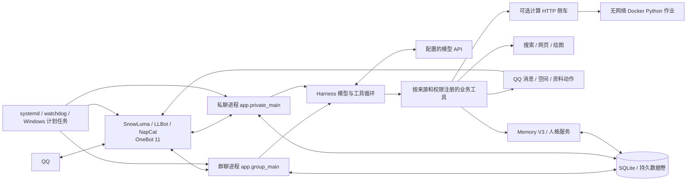

# 小町架构与运行原理

用途：系统解释；读者：开发者、部署者；维护者：项目维护者。能力按本机配置启用。

安装与操作见 [WSL 指南](../infra/wsl/README.md)，字段见 [配置参考](CONFIGURATION.md)，索引维护见 [记忆指南](MEMORY.md)。

## 系统组成

小町由 QQ 桥接、两个应用进程、持久数据库、模型/工具服务和可选计算侧车构成。应用使用 Python 3.12，Agent 循环由固定版本的 DeepSeek Harness SDK/原生运行时 0.1.5rc1 承担。

| 目录 | 职责 |
|---|---|
| `app/adapters/` | OneBot 事件/RPC、账户身份、发送、合并转发和 QQ 空间 |
| `app/agent/` | 群观察、Harness 桥接、工具注册、持续目标、产物与社交策略 |
| `app/core/` | 消息来源、回复、记忆检索、人格模仿和图片业务 |
| `app/providers/` | 文本/搜索/embedding/绘图服务适配与请求预算 |
| `app/storage/` | SQLite 表、仓储、迁移、目标和工具效果账本 |
| `app/runtime/` | 组合模型、群记忆与社交依赖，避免由路由器重复装配 |
| `app/monitor/` | 可选本机只读 Agent 输入、过程、输出与回执网页 |
| `infra/wsl/` | Linux 发布目录、Docker、systemd、看护与健康检查 |

群聊与私聊分别从`app.group_main`、`app.private_main`启动，`app.main`保留兼容入口；`NapCatGateway`可连接上述三种QQ桥接。

X/Twitter单帖媒体由共享provider解析与下载，机器人经媒体队列接入群私工具，独立CLI仍可手动运行。仅解析指定帖本身，媒体CDN及逐跳重定向受白名单、时限、重试、文件/总量限制；图片orig可恢复失败时仅降一档large，保留实际尺寸和原因并向交付层传递quality_fallbacks，自动交付注明非原图；鉴权、限流、非法URL/文件和取消不降档。视频可在同一预算尝试有限的兼容原生版本，不截短或默认转码，数值以共享媒体合同为准。配置X会话时使用下述容器爬虫。机器人结果注册到有来源的产物和受控缓存，CLI结果由调用者管理。使用方式见[工具清单](TOOLS.md)。

## 群消息处理

1. OneBot 事件转为内部类型，按群策略确定能否接收；实际消息幂等写入 `messages`。
2. `GroupAgentRuntime` 用 canonical 消息 ID 写入持久 inbox；每群单消费者领取后最多并行3个回合，另受全局`GROUP_AGENT_MAX_CONCURRENT_TURNS`限制（默认2，范围1–8）。
3. 安静 1.5 秒、最长 5 秒或达到 20 条形成批次。明确 @ 与引用机器人请求保留各自边界，旧消息回放不自动变成自主任务。
4. 观察服务校验真实发送者、群许可、消息年龄、静默时段和节奏，准备近期消息、时间、人格与记忆。
5. Harness 在有界模型/工具循环中选择发送、读取、继续目标或沉默。最终内部文本不是 QQ 消息，实际发言必须经过发送工具。
6. 工具在提交前再次验证来源、权限、预算与代际，将真实回执写入账本。

普通新消息允许模型决定是否插话。直接请求可以绕过主动插话节奏，但仍要求群可发言、来源有效、连接可用和资源预算充足。模型生成的“主人要求”“明确 @”等描述不能自行授予权限。

请求按收件箱顺序领取，按实际完成先后回复，慢请求不阻塞后续直接请求。直接回合只消费到当前目标为止，后续消息分别回答；不能回复了一条名字提及就把同批其他 @ 一并标成已处理。

主动参与另有有效新消息门槛和高价值参与规则，默认至少 4 条不同的有效发言；纯附和、复读和随口调侃不足以发言。入口与最终发送共用 `GroupObservationService`，周期群唤醒也提前检查，抑制期间不启动额外参与判定。既有事件目标到期可继续读取/整理，实际群发送仍须通过共同门控。具体配置见 [群策略](CONFIGURATION.md#群策略)。

`group_participation_feedback` 保存每群最近一条可核实的嫌烦反馈及静默/降频期限。轻量规则结合 canonical 引用、近期机器人发言和被指向的对象识别无名字的闭嘴请求；不增加逐消息 LLM 调用。反馈期限从来源时间计算，重放不能续期；发送前复验来源，撤回或过期后失效。反馈处理中不以嘴臭人格反击投诉，普通直接提问仍可回复。

## 持久状态与副作用

核心持久表包括消息、群会话/inbox/turn、目标与 wakeup、闭合会话检查点、工具效果、社交任务/动作和用量预留。原生 Harness 会话文件按账号与作用域保存到 `data/agent_sessions/`，与群事实数据库分工不同。群消息、定时观察及到期目标共用 `group:<群>` 的权威检查点、原生目录及主体锁；公开社交共用 `public`，与群私隔离，主人委派保留来源绑定的任务检查点。旧后台记录保留供回退，公开主体首次仅迁入原评论域安全闭合摘要。直接事件优先并撤销尚未派发的旧观察；已派发或未知效果必须完成账本收尾，不自动重做。CAS及来源/人格/记忆撤回检查沿用原合同。

普通单请求延续主体原生历史；重叠直接请求从主体已闭合历史建立独立执行快照，绝不并发写同一本地JSONL。结束后CAS追加各自成功摘要、来源关联和回执，下一轮按`parallel_completion`同步合并历史。快照只保留闭合应用数据，临时原生目录回收；网页仍按主体展示，并标明`parallel_snapshot`。每个私聊最多3个在途任务、私聊进程最多4个模型执行，超出容量的任务保持排队，不提前领取运行租约。重置/撤回和停止同时约束全部在途结果；同一原请求的回传等待前台收尾，其他请求继续并行，前台已完成媒体交付时不再启动回传模型。回执按来源、运行和调用码隔离，防止不同请求复用调用码时串源；已确认回执的上下文缓存限制8000字符，未知回执保留原防重约束，真实效果账本独立保存。后台媒体每进程4个worker、独立资料2个，持久领取事务及原预算、防重、未知回执不重试合同不变；单项完成即可交付，不等整个批次。

群聊和私聊的 `read_self_activity` 按上海日期查询当前机器人账号的空间发布回执，独立上下文和进程重启不影响查询。查询只读既有工具效果及历史直接发布账本，排除run_tools唤醒外壳，并对同一工具唤醒去重；成功必须已调度且有真实回执，dispatching/uncertain/缺回执的sent为未知。计数覆盖整日，明细最多64条；不返回群私来源、好友评论或后台过程。无记录只代表本系统无确认发布，不否认QQ手动活动；未知不会触发补发。

外部写入经历预留、`dispatching` 和回执提交。已派发但结果不明确时记录 `uncertain`，不能当作成功，也不自动重放。尚未派发的工作只有在来源、年龄和权限仍有效时才可恢复。消息撤回、作用域变化或撤权会使对应上下文、笔记、目标或产物失效。

工具效果按每次调用计数，模型、绘图和平台写入分别有上限。前台请求与后台目标使用不同回合预算；首个有效输出、后续停滞、单请求与整个回合都有有限超时。同步阻塞工作通过固定准入执行，取消请求不代表底层工作已经停止；发送授权会先撤销。

群私直接互动在共享Harness入口建立`RequestTaskControl`轻量目标，不依赖模型先开正式任务。保守识别明确下载/资料目标，主模型可在原回合用`set_task_goal`补充语义要求，不能扩大权限或删除明确媒体要求；普通聊天不另加规划调用。主题下载误选auto时，在schema/工具授权后仅复制参数并收紧为review，再执行完整来源/时效/完成性校验；单项和批次均适用，结果标明模式调整，直接来源auto不变；原调用签名继续去重，无需模型重发纠错。工具反馈区分搜索摘要、已读原文、来源记忆、owned产物和真实回执，日期/作者未核实不升级为事实，空搜索不证明不存在。连续无新目标证据时提示换方法，同一方法三次无进展后拒绝继续改词，首次WebSearch仍可执行；未达到可判定交付要求时发送前反馈缺口。media_selection分别记录主体、发布者、份数和未指定天数时的窗口解释；明确近N天不可放宽。同源后台回传保留目标下限及最多32项候选日期/引用/尝试记录，复验来源、依赖及7天期限，不继承旧产物权限；媒体份数排除已观察像素中的缩放/常见裁切重复。允许有据受阻或部分产物交付，不用文字冒充图片视频完成。

`ResearchTaskWorkspace`仅在内存暴露本请求的目标快照，供共享网页工具选择媒体发现模式；不读取其他请求或修改授权。Gemini媒体搜索同时传递本请求对象和时间范围，摘要内未受grounding元数据支持的URL不作为地址输出。一次搜索后最多展开3个真实来源，额外读取最多15秒、每来源最多6秒，全部共用原搜索时限和Mihomo页面传输；不递归遍历。近期目标可用来源摘要中的年月线索排序读取，线索不升级为原帖日期。HTML链接收集覆盖多个正文区域，优先原帖/媒体，避免短嵌入被长正文或分享按钮挤掉；每来源最多4条候选进入20项来源上限，目标尚未核验。有可下载候选而尚未尝试下载时，群私发送前最多纠偏2次；权限与容量受阻不强迫重试，不以单页404推断全站无法下载。Gemini搜索的8192 token输出上限同时容纳思考，避免4096上限截断真实搜索；不要求用满预算，非正常结束不算成功。

复杂目标仍复用`ResearchTaskWorkspace`保存剩余项、证据索引与下一步。Harness分别记录传输状态和任务完成度，后台待办、未知写入和缺失产物/回执不能被自报completed覆盖；正式任务尚active时不因阶段送达截断。必要时原预算内最多一次续办；反复无进展/提前结束时最多一次独立短诊断（512输出token，最多等待20秒，共用回合与每日调用额度），无工具权限、不复制主历史。失败诊断不污染主会话恢复。语义范围仍标模型报告，程序不能机械证明作者、日期或检索穷尽。取消沿用原账号、任务、群私及提问者校验。

每提问者/作用域只保存最新轻量目标，不为普通聊天逐条堆目录、不激活研究预算；正式检查点和队列负责持续任务。仅有实际产物/证据及确认交付、无未解决工具错误时记录方法经验，7天有效，匹配模型/provider及工具schema版本，撤回或依赖失效即不可读。每次按需最多提示两条简短方法，放动态尾部，不作为权限、事实记忆或人格。现有群V3保持原边界，普通私聊不新增群记忆接线。

工具定义提供稳定的执行方式和副作用说明。`read`表示不走外部写入预留，部分工具仍会保存本地状态或排队；描述性合同不授予权限，研究子任务继续使用显式只读白名单。URL可来自本次授权内发现的来源，各工具按输入类型消费URL、候选、证据或产物句柄，不能用任意字符串替换引用。站点名不决定固定调用顺序。

临时工作笔记用于继续任务，按群、来源和有效期保存，不等于长期记忆，也不直接成为人格蒸馏语料。恢复旧任务时先复验当前/原始来源、本轮200条预算和独立历史依赖快照；失败不扩张本轮来源或记忆依赖。会话增长由统一原生压缩维护，重建保留闭合任务和实际回复；原生宿主Shell/文件控制工具关闭。

## 上下文、时钟与缓存

当前上下文格式11沿用检索候选、实际入模证据与历史依赖分离。V3共享packer按独立Agent记忆预算选完整单元，自动召回不再复制近期观察，尾部不二次删已准入证据；显式工具结果仍保留协议配对。主对话总输入软阈值96000、目标64000，硬保护受模型预留约束，不再用24000历史估算抢先换段。历史来源/修订存入独立依赖表，不与当前读取200条混用，来源失效仍优先于缓存；后台任务、笔记和产物通过7天不可变快照继续复验。压缩摘要保守继承全部依赖，无法精确删除时重建该受污染执行输入；资源上限失败关闭，原始记忆与外部动作账本不被裁剪。

默认 Harness 观察使用最多30条近期消息，单群`recent_context_limit`可缩小该窗口，再保留明确目标/引用。关闭群长期记忆仍可使用近期观察；开启时接入既有`MemoryOrchestrator`的完整V3通道，近期候选通常最多60条，历史可扩至300条候选，最终由字符/token预算、证据强度、来源和保护配额决定实际放入数量。候选上限不等于每轮固定塞满。

群私`重置上下文`在模型前解析，私聊仅本人、群仅主人明确@可用。无数字为`session`：旋转执行会话，保存自动回放起点；近期只读新消息，旧记忆不预载，正常旧存档可显式检索。引用可`isolate`或`restore`，校验同会话来源后只改指定掩码；数字保留`legacy_count`，旧记录不改解释。`context_resets`保存模式/起点/目标；`context_excluded_messages`经Message标志拦截引用、转发、像素和衍生记忆。窗口不补旧消息，含隔离来源的混合摘要整块拒绝，正常原文仍可读。事务清检查点、快照、便笺、旧私聊摘要入口及未完成工作；新原生ID不重放日志。重置代次和快照撤销阻止晚回流，指令后任务保留；真实/未知写入账本不删、不重放。不推定拒绝原因，不自动重试拒绝请求。用法见[工具参考](TOOLS.md#聊天历史与感知)。

记忆工具按需追加检索结果、出处与上下文；每层默认 5 条结果，工具与正文另有限额。人格选择当前群角色，模仿时可读取至多 3 条合格表达样本；样本用于表达，不能作为事实证据。

群直接看图按当前消息、明确引用或3分钟内同发送者紧邻的指图请求选取来源；“先发图，再@问这图怎么样”仍可读取，普通文字不自动附带无关群图。主动观察仅在最新来源确为近期图片事件时附图。来源复验、每轮数量/字节上限和图像工具限制实际像素，未取得像素或指向失效时须说明缺口。

最终模型请求保留本轮及本轮工具读取的媒体，前轮媒体像素投影为省略标记，内部压缩不携带像素；原始会话/聊天和图片存储不改写。明确上游图片/输入拒绝与普通interrupted分开分类，不重试同一被拒输入。失败/未知回合不进入闭合恢复上下文或私聊日摘要；已发出回复后又发生模型拒绝、流中断或超时，同样禁止复用其执行历史，真实发送回执独立保留。失败会话下一轮换新原生ID，仍保留正常闭合历史、任务检查点和实际写入回执；格式升级同样只轮换原生执行会话，未知外部写入继续禁止重放。

会话时钟为 `Asia/Shanghai`，每个模型请求/重试刷新当前日期和昨天。历史消息附带自己的来源日期，历史里的“今天”不能替代当前时间。内部租约和持久时刻按各表约定记录 UTC，显示时再转换。

稳定规则、人格和会话前缀有利于服务端缓存；动态时间、近期消息、工具结果位于输入尾部。同一作用域与配置下，主人/成员使用相同、按名称排序的工具定义；身份只进入本轮authority观察，受限工具在执行、费用预留及副作用账本前拒绝越权。记忆引用门控、资料回传禁止再次委派及交付预算均保留定义、在调用时限制；群发送schema保持12000字符，非直接发言仍由发送层限制300字符。配置/人格变更可以改变前缀。缓存命中以上游usage为准，不用本地重复率证明。格式10仅轮换原生会话，保留闭合摘要、任务和真实回执。

V3预加载和记忆工具保留packer的精确证据块边界，原子聊天证据段不拆散；持久互动只保留一份块序列；格式10的群临时观察不写入原生历史。最终请求按活跃历史从旧到新投影，同一来源与内容的证据块、观察条目、分享来源和真实回执只提供一次，当前目标、引用、主体绑定和变化的回执仍保留。群策略只复用相邻唤醒都存在的相同规则；直接互动、普通唤醒等行动要求切换后重新出现时必须重申。去重索引每次从实际输入重建，不用全局已读标记；压缩或轮换后缺失的证据会重新提供。旧格式或块重组不匹配时保留完整正文。来源和语义版本继续在每轮及发送前复验；复用不跳过V3检索、不新增辅助模型调用。观测记录复用块/条目/回执数量及本轮输入估算，账单仍以实际usage为准。格式迁移仅轮换原生会话，正常闭合摘要、任务与真实回执按既有恢复合同保留。

群私消息始终先进入原主会话，关键词和“继续”不切换上下文。主模型判断资料量较大时显式调用 `delegate_research_task(goal, reason, deliverable, source_ids?)`，每轮最多一次；排队不等于完成。`delegated_research` 持久队列按账号/群私进程消费，子任务使用独立 `research:` 原生会话和执行器，主对话可继续回复新消息。子任务身份为专用只读执行器，不带人格、主对话历史或记忆正文；默认只传当前请求来源，模型可显式选取已见且合法的必要来源，总计最多8条。续做仅带少量检查点和证据ID。子任务从canonical来源重建网页、分享、转发及任务记录的只读工具，没有发送、行为写入或递归委派权限，来源/分享许可和费用限额仍复验。

子任务窗口最多32000 token且不超过模型窗口，输出最多4096 token，窗口55%压力处压缩、保留最多3200近期token，内部摘要最多1024输出token；每轮内部总结仍最多2次。单任务最多300秒、现有任务网页预算不变。研究和媒体队列各自按进程最多16个活动任务、每提问者每作用域最多4个；其余存为pending，活动加待办最多512个/进程、128个/提问者作用域，释放容量后依序晋升并复验。结束回传最多6000字符的结论、少量证据及资源清单句柄；全部已发现URL通过read_research_resources默认每页5项、最多20项读取，原文按证据ID分段读取。原主会话核验摘要后使用人格调用真实发送工具，结果回传轮保留定义但禁止再次委派。原请求有效的内部续办可继续获准联网，普通timer和自主巡检不获得该权限。该边界限制工作集，不承诺真实账单或完整仓库覆盖。

`data/research_tasks/` 保存7天有效的目标、覆盖、缺口、下一步与分段证据，旧任务须模型显式选择task_id。任务文件不自动导入V3事实或人格；恢复和结果回传复验原始消息、群隔离和V3语义版本。撤回/过期/更正不能通过摘要绕过；私聊重置取消该用户后台任务。队列租约900秒，只读中断最多恢复一次，投递阶段未知不自动重放；重启先恢复队列状态。当前轮正文可用于审查；前轮网页结果在发送给模型前投影成证据索引，重读须使用真实URL或本任务evidence_id。标准化相同记忆快照与原文段落只进入一次，实际交互原生日志和真实回执不改写；下述成功纯静默只回退本轮新增过程。

### 群消息观察与主动预算

最近30条为感知窗口，不是持久历史条数。群Harness在模型前本地检查新增内容、固定间隔、滚动请求和发言额度；无合格机会不调用。默认8条去重有效新消息且至少5分钟；不足8条但确有新增内容时最长等15分钟。静默不延长间隔、不作为人格偏好；纯图也可提供观察机会。每滚动60分钟最多6次主动上游请求，工具后续、重试、内部压缩及定时群观察共用；自主插话最多3次、至少间隔10分钟，分段为一次介入。明确互动、其结果回传和主人任务不占主动额度。成功轮仅推进捕获位置，后到消息不误消费；失败保留来源，尝试时间及已用额度仍保留。真实到期目标可跳过新增门槛和观察间隔，仍受请求/发言上限与静默策略约束；本地拒绝不消费目标。账号/群隔离状态、租约、待观察起点及预留原子持久化，重启不清零。

直接互动约1秒合批、最长3秒；无@接话仍须真实近期互动链。群主体在普通观察时使用同一人格核心、至多1500 token动态消息及1500 token闭合历史锚点，不预加载V3；固定规则、工具、当前媒体和按需读取另计。历史投影保留完整工具调用配对，不改原生存储；完整行动沿主历史预算，观察不将主历史压缩成小窗口。人格自己决定接话、读图/记忆或结束，不再固定先问无人格判官。普通闲聊/合适调侃允许，反馈与发送守卫照常复验。纯空轮回退原生日志追加后缀并恢复先前来源依赖，不积累重复观察或例行等待意图。主体/人格版本用于稳定缓存namespace，工具排序固定；观察采用紧凑工具profile降低冷输入，完整行动为另一profile，不承诺跨profile共用KV或渠道命中。

格式10把当前目标及有界任务结果保存进原生会话，群聊观察、记忆包和精简回执仅作为本轮临时输入，整个工具循环可用，下一轮重新提供。普通观察约3000 token软预算，召回记忆另有默认8000 token完整单元预算；当前明确目标和必要引用优先保留。完整来源依赖留在服务器守卫，不用传给模型的精简索引代替权限。无外部动作的成功静默仅回退该原生日志追加后缀；失败、取消和未知写入沿用失效轮换及不重做规则，实际操作账本不回退；已丢弃静默过程的历史估算也恢复到上一有效值，避免下一轮因不存在的历史误换段。主聊天仍能按权限查询自身空间发布和好友原帖。

### 功能执行分工

适用Harness群私交互；扩展须沿用对应类别的来源、权限与结果边界。具体启用情况以当前配置为准，稳定目录不代表授予权限。

主模型负责理解与对话；小范围历史、记忆、单页与单图读取直接执行。绘图、批量图片和网页/X视频下载使用确定性媒体队列，直接调用provider；只有多页资料研究等需要独立推理的工作才委派只读模型子任务。执行过程不进入主聊天历史，原会话只接收有界结果和产物索引。工具名、当前用法及权限统一维护在[工具清单](TOOLS.md)。

对话所有权始终由主 Agent 保持，专用任务接收明确目标、必要来源和交付要求，返回结论与证据句柄。该分工参考 [OpenAI 的 manager / agents-as-tools](https://developers.openai.com/api/docs/guides/agents/orchestration) 和 [Claude 的独立子 Agent 上下文](https://code.claude.com/docs/en/sub-agents)。后台执行与独立模型上下文是两种资源：确定性I/O不需要额外对话模型，研究子任务仍独立消耗token；隔离中间过程有助于控制主工作集，实际缓存取决于稳定前缀和上游usage。

X单帖下载复用独立provider，机器人将有效图片/视频按原帖顺序注册为有来源的产物，混合媒体通过一个合并转发提交。主题筛选以原帖正文、日期和类型为主，仅歧义时少量确认合法静态图片；不强制逐份审图，不预览视频/动图或抽帧。文案注明依据原帖，不声称看过视频、听过音频或鉴定真实性；文件解码验收与模型视觉输入分别记证。媒体统一使用容量预留、TTL、短租约和持久待回传保护；成功队列结果在有效期内不因普通缓存淘汰丢失。普通单项失败保留已校验兄弟产物，取消清理本次文件，崩溃遗留临时目录有限回收；下载、生成和平台送达分别判断。未来媒体工具须沿用[开发接入合同](DEVELOPMENT.md#媒体工具接入合同)。

群私发送及自动下载交付共用`send_media_once`，以账号、原会话、原请求source_id和排序后的产物集合认领既有效果账本。认领用独立哈希作用域及`media_delivery_once`操作，不重复消耗实际发送配额。成功必须有真实回执，后续轮询/回传或不同文案返回同一回执而不再调用QQ；reserved并发/崩溃及uncertain不重放，明确失败可有界修正一次。私聊在完整媒体目标及真实回执确认后，既有会话回执保留原请求完成标记，晚到媒体回传经来源复验直接结算；partial及未知不命中，细节见[开发合同](DEVELOPMENT.md#媒体工具接入合同)。真实发送仍受原授权/配额/派发边界约束，认领不授予新权限；新原请求允许再次交付。回归须等前台与后台路径均终结再断言实际网关调用数。

群寻址使用真实@、回复作者和明确呼叫证据；@他人后比较小町不授予直接互动资格。模型输入区分发言者、被叫到的人和被谈论的人，第二人称不自动映射到机器人；真实权限仍由来源守卫决定。

媒体队列复用jobs表及既有租约/来源守卫，群私进程分别消费，每进程最多16项、每提问者每作用域4项。入队保存参数、来源/依赖及canonical消息指纹；执行与回传复验，不存主对话原生日志。图片、引用和下载仍受既有字节/格式/来源上限；结果数据最多12000字符。`media_task_status(job_id)`只查本提问者本会话，再次检查来源，返回状态及不重放标记。执行中断、租约丢失和投递未知不自动重做；图像provider明确临时失败的一次补偿沿用原费用及总超时合同。重启可领取尚未开始/已完成待回传工作。主对话可继续聊天，下载工具选择delivery_mode=auto时，持久绑定原请求和目标，程序复验授权/来源/产物后直接打包交付，不额外唤醒模型；默认review保留主会话核验路径，适用于识别、筛选和分析，旧任务也沿用review。排队、文件生成和QQ送达分别判断。异步确认与结果回传可能增加短模型请求，是否减少费用须比较总输入、未缓存输入、输出和真实账单，不能只追求缓存百分比。

SDK-minimal显式组合0.1.5rc1的token-meter、tool-result-pruner、compaction-basic。群私主会话采用前述总输入阈值，默认保留近期最多24000 token（后台8000）、摘要群私8192/后台4096，每轮最多2次内部总结，仍受总时限和成本预留限制；独立研究窗口另按前述小预算处理。预算越限或关闭压缩时可用闭合检查点安全恢复；8MiB文件保护、未闭合执行、来源失效或模型/人格格式变化仍可轮换。摘要禁止工具选择，不运行发送循环。全请求估算含规则、schema、回放、动态尾部及图片额度，并预留输出/安全余量；估算不是上游精确tokenizer，实际usage另记。

群私确认交付且没有本轮待办时，在工具结果落库后本地闭合原生循环，省去收尾上游请求；排队确认须区分waiting，正式active任务继续执行。闭合发送完整本地协议消息，避免空输出被SDK判错而轮换会话；不产生上游usage。未知写入仍停止。Responses缓存路由提示由逻辑作用域、上游/模型、固定规则及工具schema摘要生成，不随原生会话轮换；不用于权限或恢复历史，兼容渠道可能忽略该提示，不能保证缓存命中。

网页工具默认回包6000字符，另将至多60000字符原文窗口保存为有来源证据，档案仍受原字节/总量边界限制并标注截断。批量原帖核验只返回短正文、身份/日期状态、资源角色和证据句柄；长分享URL留在索引中，不重复灌入回包。标为compact_v1且不超过12000字符的完整短摘要跨轮保持稳定；源码及被截断的正文不标为短摘要，后轮仍外置，单行超长按证据字符偏移续读而不丢弃首段。压缩和原生函数配对/不透明状态沿用原合同。下载回传默认不装载像素，显式read_artifact才进行视觉检查，生图预览保持原合同。缓存收益以上游usage衡量，前缀稳定和本地估算不代表实际命中。

上下文选择与预算统一由`conversation_context`负责：群私主聊默认近期24000 token，后台8000，按固定规则和schema估算调整压缩阈值；轻量群参与判断每次独立，研究子任务仅携带明确来源和有界任务摘要。显式重置、未闭合/失败、模型格式、8MiB保护及意外历史缺失分别记录；空巡检主动丢弃本轮追加时保持原上下文身份，不误报历史故障。后台无待办巡检提供`finish_patrol`，重复同目标的等待意图且中间无进展时本地结束，不反复写检查点；有效研究/创作及交互保留有界历史，实际回执仍独立持久化。

`responses_continuation`仅在一个活跃应用回合内优化传输。本地SDK历史始终为恢复依据；`AGENT_RESPONSES_CONTINUATION=auto`只允许官方OpenAI Responses，自定义渠道须验证后显式on。启用时应用显式store=true，否则保持SDK的store=false。只有请求配置和已确认的历史前缀一致才发送previous_response_id及新增项；实际传输完整状态含每步动态尾部并受大小/输入预算限制。新应用回合或进程从本地完整重放；请求/历史变更、压缩或未确认响应均不沿用旧指针。只有HTTP明确表示状态失效/参数不支持且尚未提交输出时才有限重发完整上下文，未知网络错误和外部写入不以此重放；显式store=false保持完整本地重放。单次response ID、服务端续接状态与prompt_cache_key分开观测，缓存实报独立计算。

## 本机 Agent 观测

回合卡片按开始时间及回合ID稳定排列；超出当前页的卡片脱离DOM但保留游标与展开状态。父回合未显示的后台任务置于顶部折叠区，加载较早回合后归回父请求，不追加到最新回合下方；缓存父回合脱离DOM时，查看父请求会先展开对应历史页。群提问与群巡检归同一群主体。

`AGENT_MONITOR_ENABLED` 默认关闭。启用后，`runtime_trace` 在最终 HTTP 发送前复制已投影、已加动态尾部的实际请求，记录回合、请求/重试/压缩、工具参数和结果、模型流输出、实际回执及 usage。侧栏优先按账号及作用域目录对应的逻辑主体归并，群提问与群巡检显示在同一群主体；原生session ID轮换在回合内分段，旧原生链接可定位所属主体。上游响应ID、续接链和缓存键哈希分别显示，不冒充上游conversation。轻量判断单独归档并标为每次独立，包含旧版带participation_judge入口的记录，原生持续上下文数为零；纯工具不计模型会话，有可验证父关联时放在父请求下。缺少逻辑标识的旧记录保留原生分组并明确证据不足。每轮记录触发、重置/格式/失败/历史缺失/空轮丢弃原因及恢复条数，观测不参与会话选择。

网页以会话侧栏和连续消息/执行流展示，每秒按事件游标读取增量，初载最近12回合、按需加载更早记录；回合开头展示「为什么开始行动」及可展开依据。群聊使用真实来源消息的@/回复事实与批次决策；定时/工作目标使用调度器已领取的到期记录，私聊使用实际消息/提醒队列的任务号和到期时间。缺少依据时明确未知，不用模型事后猜测。每步请求区分重试次数并可打开实际输入抽屉，同一执行会话的上一请求支持跨回合对照。相邻请求共有前缀字符仅为结构对照，实际缓存 token 仍以上游 usage 为准，缺失值显示未知。采集不改变输入、模型调用或发送次数，也不将记录导入上下文或记忆。

群私后台媒体和研究队列在job中保存父trace、工作流身份。监控在主请求提交工具位置展示默认折叠任务卡，可展开执行、回传、参数、产物和交付回执；刷新保留展开状态。研究子会话保留独立入口，其模型usage另计；后台工具无对话模型调用，绘图provider另计。缺失父关联时，只凭同作用域、来源消息及提问者的唯一排队/工具结果job编号补链，原始记录不改；关联有歧义或父记录过期则保留独立记录。该追踪沿用当前Harness及本机采集器，观测身份不进入模型输入、原生历史或权限判断。回传完成只证明交回主对话，QQ送达须真实回执，防重命中标为复用回执。

底部用量栏按所选会话显示当前原生执行段最近主模型请求的输入量/配置窗口：输入有usage实报则优先采用，未报时使用原有估算，旧记录缺少窗口时可采用上线时从群私实际配置读取的纯数值参考，并标当前配置参考；该参考24小时过期，无参考保持未知，不冒充历史上限；它不表示完整会话累计或精确的本地历史长度。按CC Switch归一化口径展示累计消耗、新增输入、输出、缓存命中与缓存创建：当前适配器输入已含缓存，新增输入＝输入总量－缓存命中，累计消耗＝同请求的输入总量＋输出；未单独报告的缓存创建为N/A，不能再加一次缓存。累计覆盖当前会话保留记录，含HTTP尝试和压缩，同请求结束事件去重；字段缺失保持未知或标部分。累计缓存率仅对输入/缓存均已报告的请求按token加权，展示各字段实报覆盖率；token总量不等于费用。只读metrics路由不读取请求/流快照，事件文件按游标增量读取，每轮全局最多2MiB、每文件2万行、每回合缓存128个请求，最多缓存500回合；读取未完或丢事件会标记范围不足。新请求仅额外记录配置窗口、输入预算和压缩参考阈值等标量，不修改模型正文、回放或调用次数。

公开 `reasoning_summary_text` / `summary_text` 可展示；隐藏推理只计字符进度，`reasoning_content`、原始 reasoning text、签名及加密 replay 不保存。密钥、认证头、Cookie、常见 URL 凭据和图片二进制省略。完整聊天/输入属于用户主动启用的私有检查记录，位于 `data/agent_monitor/`，不是普通日志；Linux 目录0700、文件0600，不进入 Git 或公开证据。

后台队列16项，单请求快照2MiB、单事件32KiB、每请求输出/摘要各65536字符、单回合记录32MiB；截断/丢弃会标注，故障只降级观测。下次开始或结束回合时清理24小时以前、最近100回合以外或总量超过256MiB的已结束记录；近一小时仍在运行的回合受单回合限额保护，不强制删除。服务独立运行，WSL仅监听 `127.0.0.1:8765`；Windows查看器优先8765，被保留/占用时由系统分配可用端口并保存端口状态，入口核验服务后打开或复用，始终只监听127.0.0.1；校验Host/Origin及跨站来源；不携带模型密钥，不提供聊天/控制/重试接口。查看容器仅可写挂载 `agent_monitor` 卷子目录，不能访问聊天数据库和原生执行存储；Windows回环转发失联时运行同一服务，通过WSL共享路径处理该观测目录。

群私重置提交后写监控边界（surface/scope、来源ID、UTC事务时间），聊天/效果账本不变。TraceReader过滤旧回合、旧来源晚到任务及其父流程后代，保留主体空白新轮；usage仅计新轮，无请求时token为0，命中率未知。前端轮询边界变化清空旧回合、子任务及输入抽屉。旧观测保留诊断，页面删除含隐藏记录；边界不控制执行，写失败仅降级观测。

页面确认删除调用会话DELETE路由，附同源获取的进程内随机令牌；选定会话及当时已关联的后台观测一起删除。目录只允许平铺的已知观测文件，拒绝非法ID、链接、未知文件和子目录。先将目录改名隐藏，再移除文件；Windows占用句柄在后续删除或查看器重启时重试清理。删除仅覆盖当时已采集回合；运行中的采集写入失败按原有可选观测降级，聊天、记忆、原生会话和后台任务继续，下一回合可重新显示。删除后的详情/请求/统计不可读取，前端清空对应抽屉与旧回合；统计缓存同步失效。操作见 [WSL指南](../infra/wsl/README.md#agent本机监控)。

## 记忆与人格

`messages` 是检索的原始账本。Memory V3 在原始消息投影基础上融合全文、向量、时间、人物和来源线索，再展开证据；摘要、结构化事实、人物资料和语义排序补充原始证据。索引代际准备与激活分开，避免未完成向量数据进入生产。

入站观察和后台服务持续形成话题片段、摘要/事实、FTS 和向量；Agent 也可在权限允许时使用明确的记忆写入工具。写入须同群真实来源与有效作者；关闭群记忆时不能借工具绕过。历史回填用独立维护脚本，不由每轮聊天反复触发。

人格由默认 YAML、变体、成员配置和动态 `.live.yaml` 合并后渲染进提示词。事实刷新、表达样本检索和人物口吻各有作用域；其他群的事实、关系和原话不能仅凭选择了同名人格就转入当前群。`persona_descriptions.json` 只是手工导出说明，运行时不读取。

完整流程和开关见 [记忆与人格](MEMORY.md)。

## 工具与主人委派

工具按当前作用域注册，包括记忆检索/展开、人格读取/刷新任务、群图像、转发展开、生成/编辑图、网页搜索/打开/查找、目标唤醒、隔离计算以及获批 MCP。

群私直接互动每个模型请求携带本轮 canonical 来源和实际写入状态；闭合上下文与新回执记录目标来源，历史已发送状态不能完成另一条消息。原生回合正常结束却未发生任何写入或绘图时，最多续一次原生 Agent，保留工具定义但仅允许实际调用当前群/私发送工具；纠正最多45秒，共用原总时间、模型调用和权限预算。已发送、未知/失败写入、取消、服务错误及自主沉默不触发此纠正。内部最终文字不会自动发送；仍未实际发送才返回明确失败分类供既有通知边界处理。会话格式升级时保留历史文件与有限闭合上下文，轮换原生会话。

真实 `OWNER_QQ` 可从群或私聊通过 `request_owner_action` 委派已启用行为。委派携带主人原指令和明确附件，群输入限本群；不会把整段私聊或其他群历史转给公开空间流程。主人指令不计入自主行动的冷却与次数，仍遵守权限、每轮资源和实际平台能力。

普通群成员可在允许绘图的群使用生成/编辑；私聊按固定名单或动态好友准入，并保留私聊自己的功能限制。身份切换、写记忆、平台行动与计算等操作不能由转发、昵称或模型文本取得主人权限。

## 自主社交

群插话节奏来自群策略，不额外叠加通用社交冷却。空闲群话题、空间和个人资料属于单独授权的调度表；调度只产生机会，模型可选择不行动。

空间发布/好友评论共用随机巡检：默认每 90–180 分钟一次，23:00–08:00 静默，早晨再随机延后 30–90 分钟。跨午夜、重启和到期目标不会立即抢用新日额。发布最多每日 1 条并至少相隔 18 小时；评论每好友每日最多 1 条、总额默认 3 条、每轮最多一条；主动空间写入间隔默认 60 分钟。

动态 `all_friends` 许可在读取、看图和提交时复验；好友删除、原帖消失或查询失败会阻止动作。主动评论保留帖龄门限，主人明确委派读评旧帖使用其独立权限。沉默/读取不占平台写入日额，模型调用仍按对应桶计费。未知回执不重试提交。

`public_social_records`保留14天/512条白名单公开观察、评论草稿和显式想法，优先留评论/想法，排除群私、主人任务笔记、隐藏推理和监控输入。状态按载荷匹配效果账本，修正后的成功不套到旧草稿。

自主评论和主人任务按需共用`read_social_activity`，默认5条、最多10条摘要，支持筛选/分页/详情，不预载历史；权限/会话独立，公开任务缓存键不含任务号。有界迁移只读取原生公开工具事件并核对账本，不执行QQ动作或授予权限；操作见[WSL说明](../infra/wsl/README.md)。

评论候选以原帖内容指纹分版本，`social_patrol_candidates`独立于真实发送账本。`assess_qzone_post`仅登记实际评估版本的暂缓/本版不回应及5–180分钟时效；纯图未取像素只能暂缓。整轮沉默不再批量标记已评估：未评估候选仅记录offered并暂停重复提供180分钟，之后可重看，新正文或图片版本立即重新准入。旧review表不再承担判断，保留供回退；没有依据的静默次数不进入人格或长期记忆。已派发评论仍由原帖级效果账本跨日、跨重启防重。

动态流中评论区的账号、评论 ID 和引用链接不参与原帖身份判断；评论目标仍须回到作者原帖列表核验 ID 和时间。

公开空间工具只能使用公开表达、当前许可好友的原帖和公开域产物，不能读取群私记忆。群互动、主动群聊、空间发布、评论分离模型预算。

好友动态首页可能包含超过请求 `count` 的系统记录。适配器独立限制原始页最多50条、最多核验5位作者，过滤非说说并核对当前好友、作者真实原帖ID和时间后，最多返回 `count` 条已验证原帖；数量略超请求值不会单独导致协议失败，超出绝对上限或畸形数据仍拒绝。

空间提示词和 `read_persona` 共用公开人格渲染，包含配置的语感例句；成员来源人格的原话示例、事实和私人关系仍不进入公开表达。`observe_post_images` 单次最多读取原帖9张图片，共享8 MiB下载预算和10秒时限，并报告原帖图片数、已读数和未读数；群私图片数量上限独立保持。

公开人格的完整性由 `scripts.check_public_persona` 检查真实配置与合成样本；候选镜像激活前及运行状态检查都执行。遗漏或截断例句、公开成员原话会使检查失败；检查仅输出计数、指纹和安全错误类别，不调用模型或QQ写接口。

## 合并转发与网页

`inspect_web_resources` 每轮最多6个不同目标，单目标25秒/12次有界元数据读取，整批60秒；同轮重复或失败复用短结果。Gemini/GPT搜索共用HTTP来源链接发现，额外读取不启动模型。X保存原帖作者/时间；Fantia复用gallery-dl，Bangumi条目/封面用官方API。提取器仅通过既有公网固定地址GET，禁用用户配置、浏览器Cookie、播放列表及库内下载。身份和资源角色进入证据索引，错误页、图标和封面不冒充正文；访问条件不足不强迫重复下载。

`list_x_posts`通过X公开嵌入读取指定账号的根帖子，拒绝作者不匹配，排除回复、转帖及引用帖展开；无日期默认无发布下界，明确窗口才按原帖日期筛选，最多12条，20秒有界GET。它可能只得到置顶/热门，始终不证明完整或绝对最新；返回可见最新日期、排除计数和缺口。同轮最多两种不同账号/窗口请求，成功或失败复用紧凑结果，完整元数据存原任务证据。群私共用来源授权和HTTP传输，无后台模型。RequestTaskControl以原请求绑定硬日期条件，模型检索窗口不升格为硬门，在X下载/批次入队前核验本请求所见元数据；旧帖、未知日期及异常未来时间阻止入队，用户明确要求旧帖不受近期门限制。

配置X会话后，`XCrawlerClient`在应用容器内启动有界子进程，`x_crawler`使用gallery-dl及一次twscrape备选；两库随镜像安装。宿主0700私密目录的0600会话只读挂载至群私应用，子进程不继承模型密钥，stdout只回投影。元数据与无凭据CDN下载走WSL日本代理18797，人工登录profile独立。原帖ID/作者/公开属性/日期/媒体归属校验后生成`x-posts`快照，完整性与绝对最新性仍未证明。`search_x_posts`把主体/主题、时间、类型、latest/top和显式互动门槛编译为站内查询，再核验时间/类型/数值；图片视频分路共用预算、去重并保留各类位置，摘要不裁掉唯一视频。词面命中优先但不替代语义；关键词不足可review按主体召回后依正文核验原主题，图片仅必要时少量确认，视频不预览。完整条件进入缓存，扩大窗口重查；raw须在原请求出现，不能擅改from。明确限定发布者才用账号列表。未配置会话保留公开单帖/账号路径。来源、撤回、队列、缓存和发送账本继续生效；扩站见[开发合同](DEVELOPMENT.md#x爬虫采集合同)。

原生Harness收到auto下载单项或全部接受的纯auto批次后，在工具结果落入原生会话后用本地完成帧结束主回合，持久队列继续执行和交付；该状态只代表交接，不生成发送回执或额外排队文案。review、混合或部分批次继续原主对话流程。后续并行发送调用在交接后被拦截，防止后台结果已到却又发过时进度；媒体交付仍经原来源、撤回、容量及send_media_once账本。

网页视频增加B站/抖音的受控yt-dlp解析；B站可回退原站返回的单文件MP4，保留分P身份，不把DASH单视频轨冒充完整视频。抖音需新鲜会话时明确失败，不启用浏览器。实际字节仍复用原有DownloadedMediaCache、格式/容量校验、队列和发送防重。

小红书发现通过`search_xhs_posts`，由容器内固定只读CLI复用xiaohongshu-mcp站点动作；Chrome和CLI在同一小町镜像，登录态仅留专用Docker卷0700/0600目录，仅群私应用挂载。群私共用跨进程锁，采集无MCP监听端口，模型不接触登录参数或账号写操作。搜索卡片仅为候选，原帖ID/作者/UTC日期与附件须另验；核验后的图集/视频复用既有下载、队列、来源检查点与发送账本。内部JSON投影不冒充网页HTML，CDN客户端不携带会话；日期未知/过旧的近期目标不得排队。具体上限见[小红书合同](DEVELOPMENT.md#小红书容器采集合同)。

小红书 `download_web_video` 仅取对应笔记公开H.264流，支持同笔记公开移动页回退，单视频128MiB/20分钟；以有界流写临时文件，ffprobe校验MP4/codec/时长/尺寸并由ffmpeg解码首帧。媒体由网页原像素工具相同的公网地址固定连接与逐跳校验下载，不让QQ网关自行访问外部URL。视频作为独立媒体由 `send_group/send_private(video_artifact_id=...)` 经base64传给OneBot，上传回执最多90秒且未知不重发；不与图集混发，不把已下载当观看内容。视频文件保存在独立下载目录，既有scoped artifact store只保存小型JSON指针及来源，保持原有8MiB图片/文本合同。

网页媒体清理由 `DownloadedMediaCache/DownloadedMediaJanitor` 统一负责：只清理origin为web_page_image/web_reference_pixels/web_page_video的产物及专用目录内孤儿临时文件，默认24小时/512MiB；启动和每小时扫描，下载准入前也清理并预留空间。群私以文件锁共享预算，20分钟使用租约覆盖最长回合与发送时间；正在使用的媒体不足以腾出空间时拒绝新下载。视频指针与实际文件一并清理，过期ID安全失败。其他生成作品及用户文件保留。配置与范围见CONFIGURATION；原生会话、聊天/记忆和QQ桥接自有缓存不纳入此下载缓存额度。

群私网页工具附带 `list_web_images`、`download_web_image` / `download_web_images`：解析公开 HTML 的 src/srcset、懒加载、说明及模板正文，候选ID仅本回合有效；实际像素经原有 scoped artifact store 校验，保留原文件与消息来源。每轮最多4页、160候选/页、20次下载、32MiB，单图8MiB/1600万像素，批量90秒并返回产物句柄/角色，需要视觉筛选时显式读图。直连固定公网DNS解析后的IP、保留Host/SNI，或复用独立网页代理；每跳校验，不携带模型认证或用户登录态。小红书只读取对应笔记的嵌入状态与有序imageList，桌面失败时有限回退同笔记公开移动页；视频、登录或缺失数据明确失败，不混入头像、推荐图或封面。候选与外部文字不授予权限，卡片取图沿用真实引用授权。`send_group/send_private` 普通图片最多2张；`as_forward=true` 时最多20张/32MiB，通过OneBot合并转发每图一节点，以机器人自己署名，单次发送并保留未知回执不重试边界。

群 `read_forward_messages` 仅展开已观察同群资源，默认分页 20 条、深度 3、每轮最多 8 个资源/100 节点；RPC 与载荷有限。`observe_forward_images` 读取已展开节点的图片。转发署名和日期作为未验证引用，不能授予 @ 或主人权限，也不会自动写入长期记忆/人格。私聊转发工具绑定当前用户的真实私聊来源，不能访问群消息或其他用户资料。

嵌套 XML 的 `m_fileName` 若没有独立 `m_resid`，表示外层包内的命名子记录，不能当作下载 ID。适配器按已观察父节点定位，以固定 `SsoRecvLongMsg` 只读命令取得同一外层包，限制压缩/解压载荷各 2MiB、32 个命名记录及 4096 节点；包和下载密钥仅在本轮内部缓存，不向模型公开原始包或通用协议调用。工具返回下一层完整参数 `nested_reads`（每页至多20个），分页/深度不足时显式标明。图片每节点保存至多20个允许域引用，每次实际解码2张，按 `next_image_offset` 继续；下载密钥按图片原始上传场景选择，失败索引与截断信息进入工具结果。

网页工具按回合维护引用与 URL。搜索默认 8 条、单次最多 20 条；正文、分页、查找与调用数量有总预算。Wyzlab alpha 桥接支持相应的正文命令；Gemini 原生搜索使用独立的 Google Search SSE 调用，搜索返回有真实来源的生成摘要（`grounded_answer`），不会与主聊天函数混用；open/find 和图片参考页面直接有界读取公开网站，保留B站公开文字元数据回退。缺少 grounding 来源不算搜索成功；Tavily/DDGS 的搜索消费者保留其各自合同，不保证提供同样的全文能力。GitHub 链接可按文件读取，未下载/未展开的整个仓库不能宣称已读完。raw/gist 源码保留空行及长行对应关系：1起算的 `source_line` 是实际文件行号，`L`/`next_line` 仅是分页索引；查找不把位置标记算作原文匹配。

网页独立代理仅连接项目WSL的 `127.0.0.1:18797`，不占用Windows用户代理端口7897；主模型与搜索保持直连。网页独立代理通过固定公网DoH端点核验地址，缓存不超过DNS TTL/60秒。CONNECT连接已验证的公网IP，HTTPS继续校验原域名证书并保留原Host；每次重定向独立检查。避免系统fake-IP阻断raw源码，也不允许通过代理绕过私网限制。该解析仅用于open客户端，不改系统DNS或聊天/搜索出口；GET无模型凭据，响应与时间均有界。

OneBot 的 JSON/Ark、XML 和 share 卡片在消息入口提取标题、摘要及目标 URL，排除封面和视频附件。群私初始观察与上下文工具的 `share_sources` 提供获准卡片的标题、来源和链接数；`read_message_links` 从已观察的 canonical 消息读取完整元数据。传入当前获准提问的 ID 时，仅解析该提问真实引用的唯一卡片，两条消息均须仍在观察范围且来源复验通过，不从附近或历史消息猜测目标。每条消息最多 8 个链接，单份卡片载荷最多 65536 字符。Agent 须实际读取卡片与目标正文，打不开或内容不足时按内容标题/站点搜索并阅读补充来源。卡片摘要和正文分别标注，不能当作身份、@、主人授权或已观看视频的证据。

群内任何成员须真实引用APP分享并@机器人或在正文提到小町，私聊准入用户须引用，才获当轮分享深读许可；不要求固定查看/评价动词。每次读取复验触发/引用来源与指纹。普通卡片观察仅短标题，网页工具拒绝无请求/未授权分享URL（包含检索ref映射），工具清单保持稳定。私聊当前消息按传输层直接寻址，无需名字/固定词，模型按需选联网工具。群聊仍按提问、资料请求或寻址授权。自发唤醒/巡检、旧历史/目标不新增许可。媒体/研究队列及回传继承已存寻址标记并复验原来源；旧卡深读及写操作仍受原边界限制。

B站短链/视频页被网页桥接拒绝时，`shared_page_text` 只从固定B站域名解析最多两次短链跳转，再读取公开文字元数据（标题、UP主、简介、发布时间、时长）。不发送模型凭据或Cookie，不读取音视频/字幕；标注 `content_kind=bilibili_public_metadata`，简介为空时明确证据不足。搜索仅对HTTP 429/500/502/503/504重试一次，两次尝试共用原45秒总限且均计入回合8调用；其他错误不重试，返回安全分类供Agent补充检索。

固定人格核心、规则和工具定义位于稳定前缀；动态风格样例/称呼指导以同等指令优先级放请求尾部，每次请求末尾刷新上海时钟。动态指导/时钟不写入原生历史；格式升级仅轮换一次会话并保留回执和来源。群观察仅删除已在最终记忆包展示的同源近期行；私聊延续原生会话时不重复注入整段历史/日摘要，恢复或轮换才补入。网页同轮相同查询/URL/行号/内容窗口复用成功结果，仅返回前次来源与续读信息。实际页面按HTTP出口缓存5分钟，最多8页/8MiB；命中也重验目标，失败不缓存，旧ref_id不授予跨回合访问。

## 隔离计算与部署

计算服务默认关闭。开启后应用只访问本机认证 HTTP 端点；可信 gateway 持 Docker socket，模型代码在无网络、只读根文件系统、受限 CPU/内存/PID/tmpfs 的独立容器执行。执行镜像固定到内容 ID，不回退到宿主 Python。输入/产物校验所有权、格式、大小和路径。

部署将当前工作区的运行白名单复制到 `/opt/xiaomachi/releases/<id>`，`current` 指向现役版本，环境和看护状态在 `shared`。应用配置打包在镜像中，持久业务数据在 `xiaomachi-bot-data` 卷；QQ 平台有自己的登录卷。正常 start 复用现役镜像，rebuild 构建新镜像后更新两个应用，保留 QQ 桥接。

systemd、watchdog和Windows计划任务保持进程与连接存活，QQ登录仍需人工完成。探针读取心跳、OneBot、索引与侧车；动作成功须有真实回执。

## 工程约束

- 按账号/群/用户域隔离消息、记忆、目标、会话和产物。
- 真实作者、消息来源和权威时间来自系统；引用内容均是待解释资料。
- 模型调用、检索、并发、重试、步骤、平台写入和产物均有有限边界。
- 直接群聊互动预留发送阶段，追加记忆读取达到预算后交付已有证据。Gemini Responses 仅在完整 `response.completed` 且没有拒绝时提交输出给原生执行器；之前的文字/工具调用仅供只读观测，失败则丢弃。缓冲最多8 MiB，超限结束而不提前执行。空 `interrupted` 复用原三次请求总限重试；已产生文字/工具、明确策略拒绝或未知写入不重放。普通output_text形式的relay敏感词拒绝也归类为输入拒绝。群输出记录精确 `reply_source_id`，恢复时按该来源的sent/uncertain抑制重复回复及失败通知；观察过的其他来源不被误判为已答。reserved只表示预留，不能当作成功；已进入dispatching却无回执按未知处理。
- 测试使用合成身份和隔离数据；公开仓库不包含生产数据库、人物原文或验收聊天记录。
- 支持功能和当前开关状态分别描述；依赖预发布 SDK，升级需验证工具、流和会话恢复兼容性。

持续群聊与工具/授权分工的设计参考了 [Tulpa](https://github.com/fumingyang2004/Tulpa)，感谢其作者和贡献者。

跨站媒体共享逐项READY/选择/交付/完成状态，RequestBudget贯穿后台与回传，零选中兜底及收尾无需模型。逻辑资产及字节认领复用现有效果表；整批认领创建时原子标记版本，避免不同媒体并发误入旧版围栏；未知仍不重放。约束与上限见[媒体合同](DEVELOPMENT.md#跨站媒体预算与尽力交付)。
